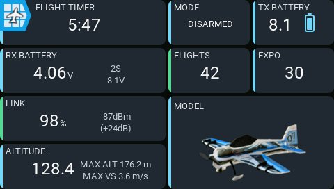

# AeroGrid

**[📖 Documentation](https://thomaskistler.github.io/aero-grid/)** · **[Releases](https://github.com/thomaskistler/aero-grid/releases)**

AeroGrid is a customizable dashboard for EdgeTX color-screen radios. Choose
flight, telemetry, battery, navigation, and control panels, then arrange them
with the on-radio editor. Save multiple layouts and choose a dark or light theme.

## Why AeroGrid?

Keep the information that matters to your model together, with consistent
readings, colors, and alerts across the dashboard.

## Download

AeroGrid requires a color-screen radio running EdgeTX 2.11.0 or later.
Follow [Install and upgrade](https://thomaskistler.github.io/aero-grid/user-guide/installation/)
for USB installation or manual SD-card copying. Upgrading replaces the old
widget folder; your saved layouts and model settings stay in `/AEROGRID/`.

## Video walkthroughs

Select a thumbnail to watch the walkthrough on YouTube.

| Install AeroGrid | Create an Empty dashboard |
| --- | --- |
|  |  |
| **Add, move, and resize panels** | **Set up model settings** |
|  |  |

## Documentation

See the [User Guide](https://thomaskistler.github.io/aero-grid/user-guide/add-dashboard/),
[panel reference](https://thomaskistler.github.io/aero-grid/reference-guide/), and
[Developer Guide](https://thomaskistler.github.io/aero-grid/developer-guide/build/).
