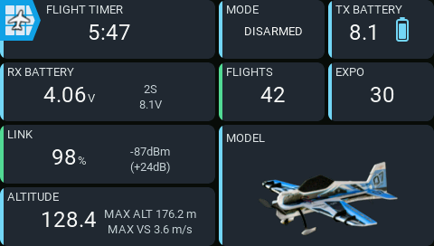

# AeroGrid

AeroGrid is a customizable dashboard widget for EdgeTX color-screen radios, arranging flight, telemetry, battery, navigation, model, output, trim, and switch-state information into configurable panels. It supports multiple model-specific layouts and an on-radio editor, with a consistent visual language throughout so readings, alerts, and controls feel like part of one cohesive dashboard.
## 

## Why AeroGrid?

EdgeTX is open source, exceptionally configurable, and a great foundation for
RC radios. Its dashboards have not always felt as modern or cohesive: many
widgets look dated, and combining widgets from different authors often produces
inconsistent typography, colors, spacing, and alarm styles.

LVGL makes it easier to build flexible interfaces around a shared design system.
Kyle Stacy's [KSE Dashboards for Rotorflight helicopters](https://github.com/kylestacy2/KSE-Dashboards)
show the potential of focused dashboards, while similarly flexible, modern
options for fixed-wing pilots remain limited.

AeroGrid aims to fill that gap with **configurable, modern-looking dashboards
and panels**: choose your information, arrange it using the built-in editor, and get a consistent
visual language across the whole dashboard.

## Download

Download the latest installation ZIP from [GitHub Releases](https://github.com/thomaskistler/aero-grid/releases). Extract the ZIP file, and copy `WIDGETS/AeroGrid/` into the SD card's
`/WIDGETS/` directory. 

## Documentation

You can find the full [**documentation**](https://thomaskistler.github.io/aero-grid/) for the User Guide, panel Reference Guide, and Developer Guide [here](https://thomaskistler.github.io/aero-grid/).
