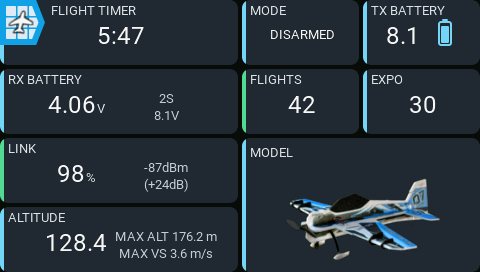
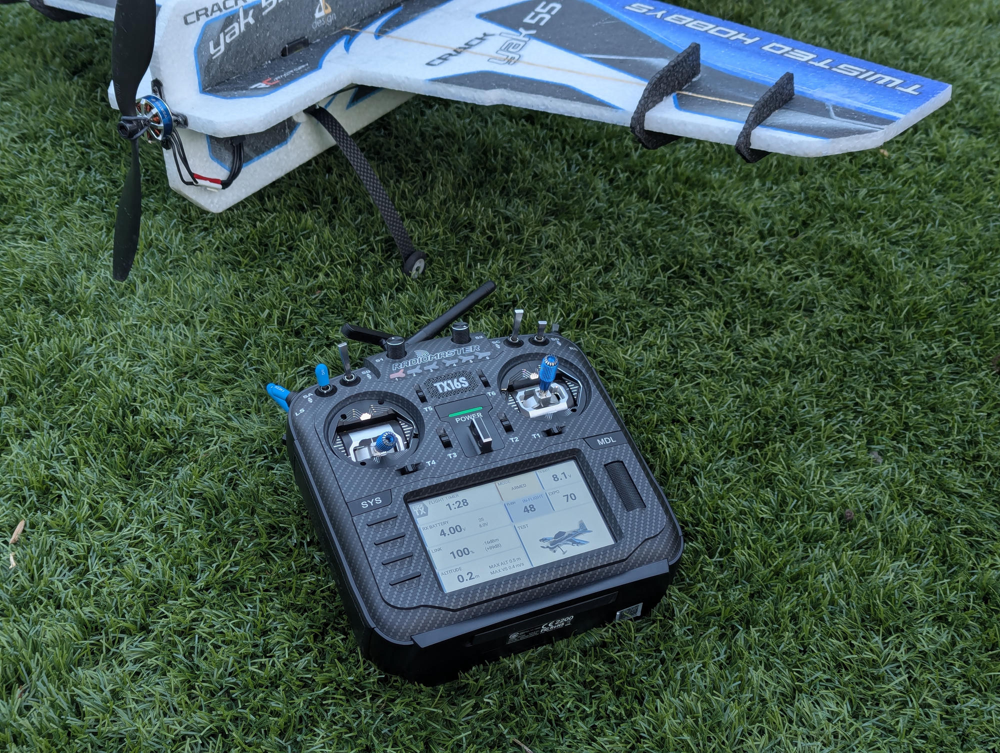
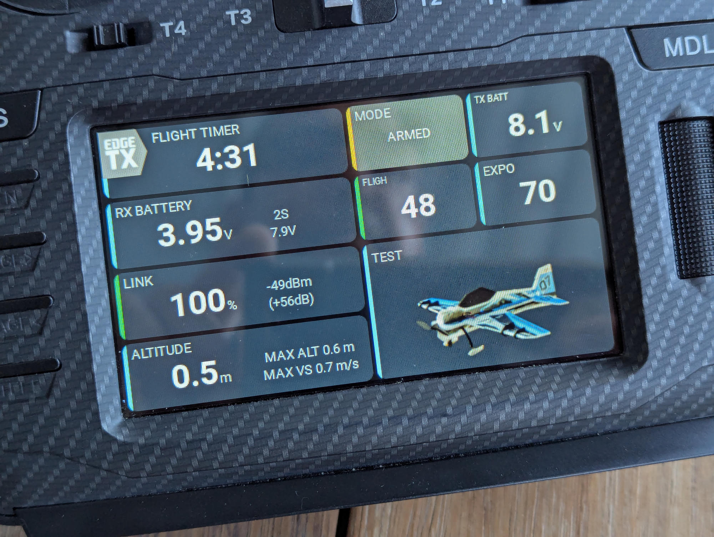
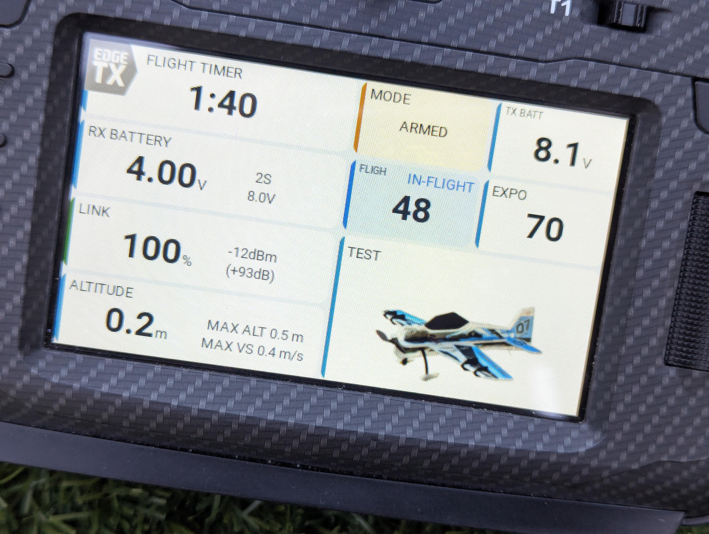

# AeroGrid

AeroGrid is a customizable dashboard for EdgeTX color-screen radios.
Choose flight, telemetry, battery, navigation, and control panels, then
arrange them on a 4 x 4 grid with the on-radio editor.

Use **Documentation version** in the header to match your installed release.
**main (unreleased)** describes the development version.

<section class="ag-home-start" aria-label="Get started with AeroGrid">
  

    START HERE
    <h2>Install or upgrade AeroGrid</h2>
    
Connect your radio and follow the guide to put AeroGrid on its SD card.

    <a class="ag-start-button" href="user-guide/installation/">Open Install / Upgrade →</a>
  

  <aside>
    <strong>Before you start</strong>
    Color-screen radio (e.g., TX16S, TX15, GX15, T16/T18)
    EdgeTX 2.11 or later
    USB data cable
  </aside>
</section>

## Choose a guide

  <a class="ag-guide-card ag-guide-card-primary" href="user-guide/add-dashboard/">
    For pilots and radio owners
    <strong>User Guide</strong>
    Install AeroGrid, create a dashboard, customize it, and troubleshoot common issues.
    <em>Start with the User Guide →</em>
  </a>
  <a class="ag-guide-card" href="reference-guide/">
    For specific answers
    <strong>Reference Guide</strong>
    Look up panel behavior, settings, and the layout YAML format.
    <em>Browse the reference →</em>
  </a>
  <a class="ag-guide-card" href="developer-guide/build/">
    For developers
    <strong>Developer Guide</strong>
    Build and test AeroGrid, learn the architecture, and contribute.
    <em>Explore development →</em>
  </a>

The Default layout in Modern Dark, with illustrative readings.

  <figure>
    
    <figcaption>AeroGrid at the flying field.</figcaption>
  </figure>
  <figure>
    
    <figcaption>Modern Dark on a RadioMaster TX16S.</figcaption>
  </figure>
  <figure>
    
    <figcaption>Modern Light on the same radio.</figcaption>
  </figure>

## Why AeroGrid?

Keep the information that matters to your model together, with consistent
readings, colors, and alerts. Save multiple layouts and choose a dark or light
theme to suit your radio.

## How to use

Follow these four short walkthroughs to install
[AeroGrid](user-guide/installation.md), create a dashboard, customize it, and
set it up for your model.

  <section>
    <h3>Install AeroGrid</h3>
    <iframe width="560" height="315" src="https://www.youtube-nocookie.com/embed/JgGA676uW7E" title="Install AeroGrid on an EdgeTX radio" loading="lazy" allow="accelerometer; autoplay; clipboard-write; encrypted-media; gyroscope; picture-in-picture; web-share" referrerpolicy="strict-origin-when-cross-origin" allowfullscreen></iframe>
    
<a href="user-guide/installation/">Read the installation guide</a> or <a href="https://www.youtube.com/watch?v=JgGA676uW7E">watch on YouTube</a>.

  </section>
  <section>
    <h3>Create an Empty dashboard</h3>
    <iframe width="560" height="315" src="https://www.youtube-nocookie.com/embed/Z-_Z-rtot8U" title="Create an Empty AeroGrid dashboard" loading="lazy" allow="accelerometer; autoplay; clipboard-write; encrypted-media; gyroscope; picture-in-picture; web-share" referrerpolicy="strict-origin-when-cross-origin" allowfullscreen></iframe>
    
<a href="user-guide/add-dashboard/">Read the setup guide</a> or <a href="https://www.youtube.com/watch?v=Z-_Z-rtot8U">watch on YouTube</a>.

  </section>
  <section>
    <h3>Add, move, and resize panels</h3>
    <iframe width="560" height="315" src="https://www.youtube-nocookie.com/embed/hJtvJaOf7YY" title="Add, move, and resize AeroGrid panels" loading="lazy" allow="accelerometer; autoplay; clipboard-write; encrypted-media; gyroscope; picture-in-picture; web-share" referrerpolicy="strict-origin-when-cross-origin" allowfullscreen></iframe>
    
<a href="user-guide/edit-dashboard/">Read the editing guide</a> or <a href="https://www.youtube.com/watch?v=hJtvJaOf7YY">watch on YouTube</a>.

  </section>
  <section>
    <h3>Set up model settings</h3>
    <iframe width="560" height="315" src="https://www.youtube-nocookie.com/embed/VtwC9R3lhOQ" title="Set up AeroGrid model settings" loading="lazy" allow="accelerometer; autoplay; clipboard-write; encrypted-media; gyroscope; picture-in-picture; web-share" referrerpolicy="strict-origin-when-cross-origin" allowfullscreen></iframe>
    
<a href="user-guide/model-settings/">Read the model settings guide</a> or <a href="https://www.youtube.com/watch?v=VtwC9R3lhOQ">watch on YouTube</a>.

  </section>

