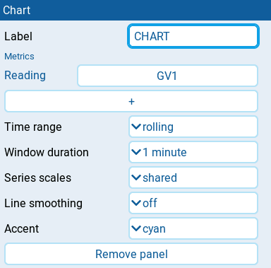
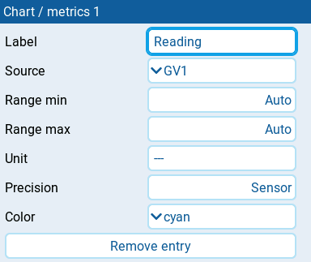

# Chart

| 2x1 | 2x2 |
| --- | --- |
|  |  |

Records up to three numeric EdgeTX sources on one chart while armed.
The legend shows each recorded value and its minimum and maximum.
Use separate panels for separate charts.

## Settings

| Setting | Default | What it does |
| --- | --- | --- |
| **Label** | empty | Optional chart heading. Clear it to hide the heading. |
| **Metrics** | none | Up to three readings. Tap **+** to add one, or tap an entry to edit it. |
| **Time range** | growing | **growing** keeps the recording from the start; **rolling** shows the latest fixed window. |
| **Window duration** | 1 minute | **30 seconds**, **1 minute**, **2 minutes**, **5 minutes**, or **10 minutes**. Shown only when **Time range** is **rolling**. |
| **Series scales** | shared | **shared** uses one vertical scale; **independent** gives each metric its own scale, useful for unlike units. Independent trace heights are not directly comparable. |
| **Line smoothing** | off | **off**, **light**, **medium**, or **strong**. Smooths the line only, not the recorded value or extrema. |
| **Accent** | cyan | Panel stripe color: **cyan**, **green**, **amber**, or **orange**. Does not change trace colors. |

Before recording, set the dashboard's
[`session.armSource`](../reference-guide/yaml.md#session) in its layout YAML.
This setting is YAML-only. Choose a numeric EdgeTX source such as `sa` or
`ch5`; positive means armed, zero or negative means disarmed.
See the [Chart YAML example](../reference-guide/yaml.md#chart).

### Metric entry

Tap a reading under **Metrics** to open its settings.

| Setting | Default | What it does |
| --- | --- | --- |
| **Label** | source name | Name in the legend. Clear it to use the source name. |
| **Source** | required | Numeric EdgeTX source to record. |
| **Range min**, **Range max** | Auto | Optional lower and upper vertical bounds, in steps of 0.1. Step below the lowest numeric value to select **Auto**. If both are set, maximum must exceed minimum. |
| **Unit** | sensor unit | Unit text beside the value. Changes the label, not the number. |
| **Precision** | Sensor | Decimal places, 0 to 3. Step below 0 to select **Sensor**, using the source's precision. |
| **Color** | by entry order | Trace and legend color: **cyan**, **green**, **orange**, or **amber**. Defaults to cyan, orange, then green; cyan uses blue ink in Modern Light. An explicit choice keeps that color. |
| **Remove entry** | | Deletes this reading. |

## Behavior

Recording starts when armed, pauses when disarmed, and resumes the same
recording on rearm. Disarmed time takes no horizontal space. Dashed markers
and breaks in the line mark disarm/rearm boundaries and missing telemetry.
Readouts freeze while disarmed. Minimum and maximum cover all recorded armed
periods, even in rolling mode.

**Growing** starts at one minute and expands in whole-minute steps as
cumulative armed time increases. **Rolling** drops plot history outside
**Window duration**, but keeps the recorded minimum and maximum.
Faint solid lines mark armed-time intervals; the bottom-right label shows
the visible duration.

Each vertical bound can be fixed independently: set only **Range min** to
anchor the bottom, only **Range max** to fix the top, or both for a fixed
range. **Auto** follows recorded extrema with some padding. With **shared**
scales, the lowest configured minimum and highest configured maximum apply
to all traces; an unset side follows all metrics automatically. With
**independent** scales, each metric uses its own bounds. Fixed bounds clip
the plot, not recorded values or extrema.

Smoothing reduces short-term fluctuations in the line. **Light**,
**medium**, and **strong** respond over approximately 0.5, 1, and 2 seconds.
Missing or stale readings leave gaps and dim the last value rather than
recording a false zero; a fresh numeric zero is valid.

If **HISTORY FULL** appears, existing plot history is preserved and new plot
samples stop for the full series. Armed readouts and extrema continue
updating. Rolling mode frees space as old history leaves the window.

History is held in RAM, not saved to the SD card. It continues while the
dashboard receives background updates. Reloading or restarting the dashboard,
including applying editor changes that rebuild it, clears history.
There is no separate reset control.

## States

| Message | Meaning |
| --- | --- |
| **SET ARM SOURCE** | Set `session.armSource` in YAML; recording is disabled without it. |
| **ARM N/A** | The configured arm source is unavailable; recording is paused. |
| **ADD METRICS** | Add a source in the panel settings. |
| **WAITING FOR ARM** | No samples have been recorded yet. |
| **NO DATA** | Armed, but no configured source has supplied a valid numeric sample. |
| **HISTORY N/A** | History is unavailable; consult [Host diagnostics](host-diagnostics.md). |
| **HISTORY FULL** | A series has stopped adding plot samples to preserve its recording; armed readouts and extrema still update. |
