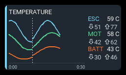
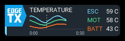

# Chart

One chart overlays up to three numeric telemetry sources. Its title sits above
the plot; the compact right legend groups each source's name and recorded value
with its recorded minimum and maximum on the next line.

## Settings

| Setting | Purpose |
| --- | --- |
| **Label** | Title above the plot. Empty uses the source name for one series, or CHART for multiple series. |
| **Metrics** | Zero to three sources. Tap **+**, then choose each entry's **Source**, optional **Label**, **Unit**, **Precision** (0–3, or Sensor), and **Color**. |
| **Range min**, **Range max** | Optional per-entry vertical bounds. Both default to **Auto**, one step below the lowest allowed numeric value. Select a number to fix that bound, or return to **Auto** to clear it. If both are entered, maximum must exceed minimum. |
| **Time range** | Growing keeps the recording visible by doubling its time scale; rolling shows the latest fixed window. |
| **Initial / window duration** | 30 seconds, 1 minute, 2 minutes, 5 minutes, or 10 minutes. This is the initial growing range or the rolling window. |
| **Series scales** | Shared uses one vertical scale. Independent gives each trace its own scale, suitable for voltage/current or RSSI/link quality. Independent heights are not directly comparable. |
| **Line smoothing** | Off, light, medium, or strong. The exponential filter has approximately 0.5, 1, or 2 seconds of response time; only the line is filtered. |
| **Accent** | Panel stripe color, independent of trace colors. |

Configure the dashboard's shared `session.armSource` in its layout YAML before
recording. It is a numeric EdgeTX source, such as `sa` or `ch5`; positive means
armed. This dashboard setting is currently YAML-only. See the
[YAML reference](../reference-guide/yaml.md#chart).

### Vertical bounds

Each bound is independent: set only **Range min** to anchor the bottom while the
top grows automatically, set only **Range max** to fix the top, or enter both for
a fixed range. **Auto** follows raw recorded extrema with padding and rounded
bounds. Explicit bounds clip the plot, not the recorded values or legend extrema.
An automatic bound always leaves a nonzero span, even if all readings fall
outside the configured opposite bound.

With **Shared** series scales, the lowest entered minimum and highest entered
maximum define the common bounds. If nobody specifies one side, that side follows
all series' recorded extrema automatically. With **Independent**, each metric's
bounds apply only to its own trace. The former panel-wide **Value range** selector
is no longer needed.

## Behavior

Recording starts when armed, pauses when disarmed, and **continues the existing
recording on rearm**. Disarmed time does not occupy horizontal space. A dashed
marker and a broken trace distinguish resumed recordings or gaps in telemetry.
The right-hand value freezes when disarmed; the down/up arrows show raw minimum
and maximum across all recorded armed periods, including in rolling mode.

Growing mode starts at the selected duration. Exceeding 30 seconds, for example,
changes the range to 60 seconds, shrinking existing history into the left half.
Rolling mode discards old plot detail while preserving lifetime recorded extrema.
The axis labels show cumulative armed time.

Sources share firmware polling with other panels. Raw extrema are collected at
each successful poll, even when the chart redraws less often. Drawing frequency
adapts to the horizontal time resolution. Bounded display buckets retain first,
last, minimum, and maximum points; long recordings are progressively coarsened,
not stored as a full-resolution log. Old interruptions may lose plot detail
during compaction, but the service never joins across a known gap.

All series occupy **one plot**, not separate mini-charts. Use multiple panels for
separate charts. Supported spans are 2x1, 3x1, 4x1, 2x2, 3x2, 4x2, 3x3, 4x3,
and 4x4; additional height goes to the plot rather than stretching the legend.
The panel respects the App menu exclusion area.
Metric names, values, and extrema use the same larger legend font at every span.
When the panel is too short to fit all extrema rows (for example, three sources
in a 2x1 panel), those rows are hidden rather than shrinking the text or
overlapping the recorded values. Use a taller panel to show all readouts.

History lives in RAM and continues while the dashboard receives background
callbacks. Geometry-only reflow preserves it. Reloading/restarting the dashboard,
including applying editor changes that rebuild it, clears history. There is no
separate reset control or persistent recording.

## States

Missing telemetry creates a gap and dims the last recorded value, without recording a false zero.
An actual fresh numeric zero remains valid.

| Message | Meaning |
| --- | --- |
| **SET ARM SOURCE** | Configure `session.armSource`; recording is disabled without it. |
| **ARM N/A** | The configured arm source is unavailable; recording is paused. |
| **ADD METRICS** | Add a source in the panel settings. |
| **WAITING FOR ARM** | No samples have been recorded yet. |
| **NO DATA** | Armed, but no configured source has supplied a valid numeric sample. |
| **HISTORY N/A** | The history service is missing or has failed; consult diagnostics. |
