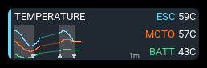
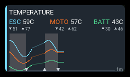
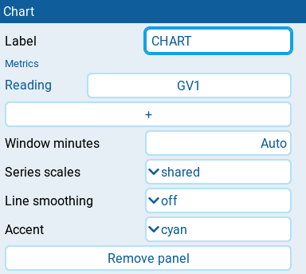
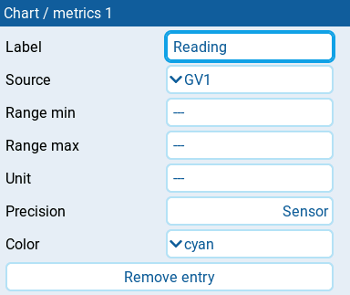

# Chart

| 2x1 | 2x2 |
| --- | --- |
|  |  |

Records up to three numeric EdgeTX sources on one chart while armed or in flight.
The legend shows each recorded value and its minimum and maximum.
Wide layouts keep the legend on the right. Square and tall layouts put it above
the full-width plot, with two or three metrics arranged left to right. Each metric
uses two lines: its name and value, then its minimum and maximum.
Live readings do not change the plot width. Legend text shrinks to fit; values
that still cannot fit show `...` instead of a truncated number.
Use separate panels for separate charts.
Select **Arm switch** in **AeroGrid → Model settings**; changes save automatically.
Until model arming has been saved, an existing panel arm switch remains in use
and visible. Saved model arming overrides it on every dashboard; saved **None**
disables recording rather than restoring the fallback.

## Settings

| Setting | Default | What it does |
| --- | --- | --- |
| **Label** | empty | Optional chart heading. Clear it to hide the heading. |
| **Metrics** | none | Up to three readings. Tap **+** to add one, or tap an entry to edit it. |
| **Window minutes** | Auto | **Auto** grows the window as recording continues. A whole number of minutes from 1 to 60 fixes it. |
| **Series scales** | shared | **shared** uses one vertical scale; **independent** gives each metric its own scale, useful for unlike units. Independent trace heights are not directly comparable. |
| **Line smoothing** | off | **off**, **light**, **medium**, or **strong**. Smooths the line only, not the recorded value or extrema. |
| **Accent** | cyan | Panel stripe color: **cyan**, **green**, **amber**, or **orange**. Does not change trace colors. |

### Metric entry

Tap a reading under **Metrics** to open its settings.

| Setting | Default | What it does |
| --- | --- | --- |
| **Label** | source name | Name in the legend. Clear it to use the source name. |
| **Source** | required | Numeric EdgeTX source to record. |
| **Range min**, **Range max** | Auto | Optional fixed lower and upper vertical bounds, in steps of 0.1. If both are set, maximum must exceed minimum. A cleared bound is **Auto**. |
| **Unit** | sensor unit | Unit text beside the value. Changes the label, not the number. |
| **Precision** | Sensor | Decimal places, 0 to 3. Step below 0 to select **Sensor**, using the source's precision. |
| **Color** | by entry order | Trace and legend color: **cyan**, **green**, **orange**, or **amber**. Defaults to cyan, orange, then green; cyan uses blue ink in Modern Light. An explicit choice keeps that color. |
| **Remove entry** | | Deletes this reading. |

## Behavior

Recording starts when the effective armed condition is active. When shared
flight detection uses that same condition, recording continues through the
disarm grace until flight end is confirmed, even while the chart is hidden.
Rearming during grace keeps one uninterrupted flight. Without a qualified,
matching flight, disarming pauses recording immediately.

A neutral background band identifies each flight behind the grid and telemetry
traces: lighter in dark themes, darker in light themes.
Its edges use the actual flight times, not the later
qualification or confirmation times; an active flight's band grows with the
recording. Grace-period samples remain on the chart beyond the band's end.
No Flight counter panel or logical-switch output is required. A chart opened
mid-flight shades only the recorded portion.

Upward triangles on the bottom axis mark arming; downward triangles mark disarming.
The first arming that starts recording is not marked.
Pausing simply stops the traces, without a label or stop marker.
Resuming inserts a gap; faint lines in each trace's color
connect the last recorded values to the resumed values.
The gap is 24 pixels wide in a fixed window and narrows as an **Auto** window grows.
It indicates omitted time, not the length of the pause, and uses space in the window.
Missing telemetry breaks the traces without adding a pause gap or connector.
Consecutive valid readings are connected: each screen column shows its minimum
and maximum and joins the previous column's last value. When readings arrive less
often than once per column, the trace holds the last value until the next reading.
Readouts freeze when recording pauses. Minimum and maximum cover all recorded periods.

The horizontal axis starts at recording time zero. With **Auto**, the window
starts at 1 minute; when the plot is full it compresses to 2, 3, 4, 6, 8, 12, 16,
24, 32 minutes and so on, keeping all earlier data on screen. When a fixed window
is full, it slides left by 1 minute; the oldest minute leaves the plot. Resizing
the panel or resetting the session clears the plot. Earlier saved
growing/rolling choices are ignored; saved durations that are not whole minutes
round up, and longer ones are limited to 60 minutes.
Faint solid grid lines mark recording-time intervals; the bottom-right label shows
the recording-time window. Pause gaps can fill the window sooner.

An **Auto** bound starts close to the first reading. When drawn data leaves the
range, the plot is redrawn at a wider range, typically within a second: the range
at least doubles and fits the data with some headroom. Auto bounds only grow until
the panel is resized or the session is reset. With **shared** scales, the lowest
configured minimum and highest configured maximum apply to all traces, and Auto
sides follow all traces. With **independent** scales, each metric uses its own
bounds. Fixed bounds clip the plot, not recorded values or extrema.

Smoothing reduces short-term fluctuations in the line. **Light**,
**medium**, and **strong** respond over approximately 0.5, 1, and 2 seconds.
Missing or stale readings leave gaps and dim the last value rather than
recording a false zero; a fresh numeric zero is valid.

If **HISTORY FULL** appears, existing plot history is preserved and new plot
samples stop for the full series. Readouts and extrema continue
updating.

History is held in RAM, not saved to the SD card. It continues while the
dashboard receives background updates. Reloading or restarting the dashboard,
including applying editor changes that rebuild it, clears history.
Each append consumes telemetry received since the previous append, summarizes
the affected pixel columns, and draws only those columns.
Charts do not reconstruct traces from stored history. Opening or resizing a
chart starts an empty plot; only subsequent telemetry is drawn in the fixed
recording-time window. Editor previews do not replay history or record new data.
New sources show an explicit no-data preview until saved.
Flight overlays retain the latest 64 intervals; missing earlier boundaries are
not guessed.
Use **Session reset switch** in
[Model settings](../user-guide/model-settings.md#session-reset) to clear recordings,
extrema, and markers across all dashboards.

## States

| Message | Meaning |
| --- | --- |
| **SET ARM SOURCE** | Select **Arm switch** in Model settings; recording is disabled without an effective switch. |
| **ARM N/A** | The selected armed switch condition is unavailable and no matching active flight is keeping recording running. |
| **ADD METRICS** | Add a source in the panel settings. |
| **WAITING FOR ARM** | No samples have been recorded yet. |
| **NO DATA** | Recording, but no configured source has supplied a valid numeric sample. |
| **HISTORY N/A** | History is unavailable; consult [Host diagnostics](host-diagnostics.md). |
| **HISTORY FULL** | A series has stopped adding plot samples to preserve its recording; readouts and extrema still update. |
| **PREVIEW** | An edited chart displaying compatible existing history without changing recording. |
| **PREVIEW: NO DATA** | A new or incompatible recording configuration; sampling starts after saving. |
