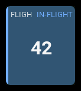
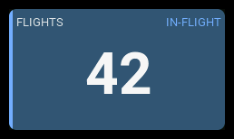
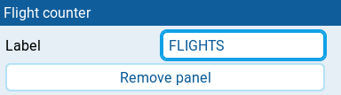

# Flight counter

| 1x2 | 2x1 | 2x2 |
| --- | --- | --- |
|  |  |  |

Displays the model's GV9 flight total and highlights a detected active flight.
Flight tracking is shared by AeroGrid dashboards and does not require a visible
Flight counter.

## Settings

| Setting | Default | What it does |
| --- | --- | --- |
| **Label** | FLT | Panel heading. Clear it to restore the default. |

Configure arming, detection, optional sounds, and the required **GV9**
reservation in [Model settings](../user-guide/model-settings.md#flight-detection).
Those settings apply across the model's dashboards; this panel only configures
its label. For migration, see
[Older layouts](../user-guide/model-settings.md#older-layouts).

## Behavior

Each confirmed flight start increments the total once. Detection continues
on hidden dashboards and does not depend on the number of counter panels.
Telemetry loss or reducing motor output after confirmation does not end a
flight. Continuous disarming for the configured end window does; rearming
within that window keeps the same flight open. An unavailable arm reading
cannot confirm disarming.

If dashboard arm conditions conflict or settings change during a flight, the
current flight finishes using its original condition and output. New flights
wait until the configuration is consistent.

The [Session reset switch](../user-guide/model-settings.md#session-reset)
cancels detection and clears its output without changing GV9.
Disarm before another flight can be counted. AeroGrid does not write flight CSV files.

GV9 persists through model saving and transmitter restarts, but in-flight
detection state does not. Changing model or restarting during a flight can
lose its history and qualify it again.

## States

| Condition | Presentation |
| --- | --- |
| Resting or qualifying | Count and normal styling, without a badge. |
| Qualified flight or pending disarm timeout | Count, blue active styling, and `IN-FLIGHT` badge. |
| Confirmed completion | Count retained and normal styling restored. |
| GV9 unavailable | `--` and an `N/A` badge. |
| Configuration or persistence failure | Actionable service error; resolve it before relying on tracking. |
