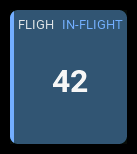
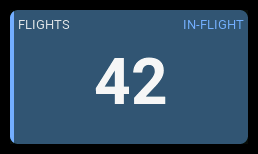
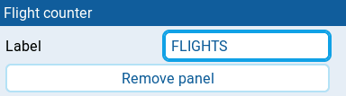

# Flight counter

| 1x2 | 2x1 | 2x2 |
| --- | --- | --- |
|  |  |  |

Counts qualifying flights, stores the total in GV9, and highlights an active flight.

## Settings

| Setting | Default | What it does |
| --- | --- | --- |
| **Label** | FLT | Panel heading. Clear it to restore the default. |
| **Armed switch position** | SF↑ | Switch position that means armed. Choose a physical switch position or a logical switch that is true while armed. |
| **Motor channel** | CH3 | Motor channel used to check whether the motor is running. Select your model's actual throttle channel. The picker is restricted to channels. |
| **Reversed motor channel** | off | Reverse the channel reading before calculating motor percentage. Enable it if the selected channel runs from high at idle to low at full power. |
| **Minimum motor percent** | 25 | Motor percentage must be strictly above this value to qualify. Valid values are 0 up to, but not including, 100. Whole-number values change in steps of 1. |
| **Qualification seconds** | 30 | How long armed, sufficient motor output, and live telemetry must hold continuously before a flight counts. Must be greater than 0 and at most 3600 seconds. Whole-number values change in steps of 1. |
| **Disarm seconds** | 10 | Continuous disarming needed to confirm the end of a counted flight. Must be greater than 0 and at most 3600 seconds. Whole-number values change in steps of 1. |
| **Announce flights** | off | Play a tone and speak the total when a flight qualifies and when its end is confirmed. No external sound files are needed. |
| **Write CSV history** | on | Append confirmed completed flights to `/flights-history.csv` on the SD card. |

## Behavior

A flight qualifies when **Armed switch position**, **Minimum motor percent**,
and live telemetry hold continuously for **Qualification seconds**. Any
interruption before qualification resets the attempt. Qualification increments
the total once. Motor percentage maps the channel's normal low-to-high travel
to 0–100%, after applying **Reversed motor channel**.

**Armed switch position** belongs to this panel only. If using session extrema
or a separate State panel, configure their armed conditions to agree with it.
An unavailable arm reading cannot confirm disarming.

After qualification, telemetry or motor changes do not end the flight.
Continuous disarming starts the **Disarm seconds** timeout. Re-arming before
it expires cancels the pending end without counting again. A callback gap of
more than one second restarts qualification or a pending end timeout rather
than assuming the condition held while unobserved. Tracking continues while
this dashboard is hidden, once the panel has loaded.

Reserve GV9 in flight mode 0, with precision 0 and limits allowing 0–999.
The existing total is kept, including one previously written by EdgeTX
Flights. Invalid, full, or unsavable counts cause a panel error rather than
wrapping. Use one tracking panel across all dashboards for a model, and do
not also run EdgeTX Flights. To show the total elsewhere, use a read-only
Metric panel with source GV9; configure other flight modes to inherit GV9
from flight mode 0.

**Write CSV history** records only confirmed completions. It uses the same
five columns as EdgeTX Flights: flight date, model name, flight count,
duration, and model identifier. Model names are CSV-quoted when needed.
Duration runs from the start of qualification to the final disarming; the
disarm grace period is excluded. History does not restore or calculate GV9.
SD-card failures cause panel errors; the already saved count is retained.

GV9 persists through model saving and transmitter restarts, but in-flight
detection state does not. Changing model, reloading the dashboard, or
restarting during a flight can lose its history and qualify it again.
Do not reload the tracking dashboard during flight.

## States

| Condition | Presentation |
| --- | --- |
| Resting or qualifying | Count and normal styling, without a badge. |
| Qualified flight or pending disarm timeout | Count, mist blue surface, blue accent, and `IN-FLIGHT` badge. If the blue surface would be illegible, the surface keeps its normal color. |
| Confirmed completion | Count retained and normal styling restored. |
| GV9 unavailable | `--` and an `N/A` badge. |
| Invalid configuration, persistence, or history failure | Panel error; tracking is disabled. |
