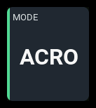
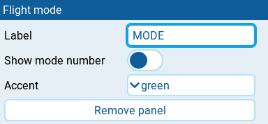

# Flight mode

| 1x2 | 2x1 | 2x2 |
| --- | --- | --- |
|  |  |  |

Shows the transmitter's current EdgeTX flight mode by name.

## Settings

| Setting | Default | What it does |
| --- | --- | --- |
| **Label** | MODE | Panel heading. Clear it to restore the default. Longer headings need a wider panel. |
| **Show mode number** | off | Show the EdgeTX flight mode number beneath the name when space permits. Single-row panels hide it. |
| **Accent** | green | Color used for the normal state: **cyan**, **green**, **amber**, or **orange**. |

## Behavior

This is EdgeTX's own flight mode, one of the up-to-nine mixer modes
configured on the radio. Each can have its own trims and rates. The panel
reads the active mode from EdgeTX rather than inferring it from switches.
An unnamed mode shows as `FM0`, `FM1`, and so on.

**Show mode number** adds a supporting row such as `#1`, using EdgeTX's
numbering from 0. The row disappears when the panel is too short and returns
when space permits. The mode name is fitted using the widest mode name in
the model, so switching modes does not resize the reading.

The reading is radio-local, so telemetry loss does not make it stale.
There are no alarm thresholds.

## States

| Condition | Presentation |
| --- | --- |
| EdgeTX reports a flight mode | Mode name and normal accent, without a badge. |
| Flight mode information is unavailable | `--` and an `N/A` badge; the supporting row is `#--` when shown. |
