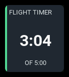
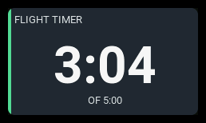
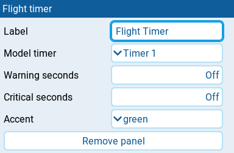

# Flight timer

| 1x2 | 2x1 | 2x2 |
| --- | --- | --- |
|  |  |  |

Shows one of the radio's own model timers, following its elapsed or remaining
time display.

## Settings

| Setting | Default | What it does |
| --- | --- | --- |
| **Label** | timer name | Panel heading. Clear it to use the timer's configured name, or `TIMER 1`, `TIMER 2`, or `TIMER 3` when unnamed. |
| **Model timer** | Timer 1 | The EdgeTX model timer to show: Timer 1, Timer 2, or Timer 3. |
| **Warning seconds** | Off | Time threshold for the warning state, in whole seconds from 0. Step below 0 to reach **Off**. |
| **Critical seconds** | Off | Time threshold for the critical state, in whole seconds from 0. Step below 0 to reach **Off**. |
| **Accent** | cyan | Color used for the normal state: **cyan**, **green**, **amber**, or **orange**. Alarm states use the shared state colors instead. |

## Behavior

Configure the timer's name, start value, activation mode or switch, and
elapsed or remaining display in **Model Setup → Timers** on the radio.
**Model timer** chooses which one the panel reads. The timer keeps running
under EdgeTX's control even when this dashboard is hidden.

**Warning seconds** and **Critical seconds** follow the timer's direction.
A countdown reaches a threshold at or below it; a count-up timer reaches
it at or above it. The boundary value counts, and critical takes priority.
Countdown alarms always use remaining time, even when the clock shows
elapsed time. A countdown below zero is always critical, regardless of
thresholds. At exactly zero, only configured thresholds apply.

Larger panels reveal a supporting row: `OF` followed by the countdown's
start time, `COUNTING UP`, or `EXPIRED`. A countdown also gains a progress
bar when space permits, filling as time is used. The clock retains its
minus sign when showing negative time. When elapsed time is selected, the
expiry badge and supporting row still identify an expired countdown.

## States

| Condition | Presentation |
| --- | --- |
| Timer available, no crossed thresholds | Clock and normal accent, without a badge. |
| Timer reaches **Warning seconds** in its own direction | `WARN` badge and warning color. |
| Timer reaches **Critical seconds**, or a countdown runs below zero | `CRIT` badge and critical color; `EXPIRED` supporting row for an expired countdown when space permits. |
| Timer cannot be read | `--:--`, an `N/A` badge, and `NO TIMER` supporting row when space permits. |
