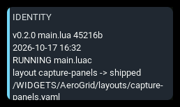
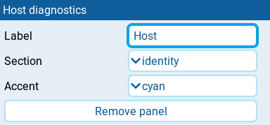
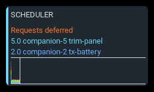

# Host diagnostics

Helps investigate dashboard loading, panel failures, and missing sources.
Reports describe the dashboard containing this panel; the shared log can
include events from other AeroGrid dashboards.

The panel needs at least 2x2 cells to fit its rows.

## Settings

| Setting | Default | What it does |
| --- | --- | --- |
| **Label** | section name | Panel heading. Clear it to use the selected **Section**. |
| **Section** | identity | Report to show: **identity**, **theme**, **panels**, **sources**, **log**, or **scheduler**. |
| **Maximum log entries** | 64 | Shown for **log**. Retains 1–256 messages radio-wide. When several log panels exist, the largest requested limit applies. |
| **Accent** | cyan | Normal panel accent. Diagnostic messages do not change it. |

## Behavior

Reports refresh about twice per second and show up to twelve lines, limited
by panel size. Enlarge the panel if rows are hidden.

### Identity

Select **identity** to see the AeroGrid version, selected layout and file path,
model filename, and main-script information. `RUNNING main.luac` warns that
compiled code is present and may be preferred over the source.

### Theme

Select **theme** to see the selected theme, any fallback, and related notices.

### Panels

Select **panels** to see panel IDs, types, sizes, and failures. Rejected and
failed panels appear first, with their error text.

### Sources

Select **sources** to see requested telemetry sources and whether they bind.
Unbound names appear first; check their spelling and the radio's Telemetry page.

### Shared log

Select **log** before reproducing a problem. A live log panel on any AeroGrid
dashboard enables shared recording, even when hidden; editor previews do not.
Navigation records first-arm capture outcomes and unavailable arm switches,
without GPS coordinates.

In widget fullscreen, tap the panel to read retained messages. Drag down or
turn the wheel left for older lines; drag up or turn right for newer lines.
The viewer freezes its contents until reopened. **Close** or **RTN** returns
to the dashboard.

**Maximum log entries** controls retention; the largest live panel setting
applies across dashboards. Oldest messages are dropped when full. Removing all
log panels stops recording. Logs are not saved and are lost after restarting.
For raw-field interpretation, see
[Simulator logs and caught errors](../developer-guide/testing.md#simulator-logs-and-caught-errors).

### Scheduler

Select **scheduler** to see two lines, with one point added each second at most:
the cyan line is the percentage of scheduler slots used, and the orange line is
the percentage of due requests deferred because no slots were available.

The cursor marks the newest point and wraps to the left when full.
Resizing clears the graph. The view measures this widget's accounted work,
**not actual CPU usage**. Measurement continues on hidden screens but is not
enabled by editor previews.

## States

| Condition | Presentation |
| --- | --- |
| Report available | Diagnostic lines with the normal **Accent**; no alarm badge. |
| Main script cannot be inspected | `main.lua unreadable` alongside the package version; other identity lines still appear. |
| Compiled main script present | `RUNNING main.luac` near the top of the identity report. |
| Panels rejected or failed | Failure count and `REJECTED` or `FAILED` lines before healthy panels; normal panel colors remain. |
| Sources cannot bind | Unbound count and source names marked `UNBOUND` before bound sources. |
| No theme, panels, telemetry service, or subscriptions | `no theme`, `no panels`, `no telemetry service`, or `no sources subscribed` in the corresponding report. |
| Host unavailable or section unrecognized | `no host` or `no section` followed by the requested section. |
| Report raises an error | `report failed:` followed by the error text. |
| Report exceeds available space | Trailing lines are hidden; no warning badge is added. |
| Log exceeds available space | Newest messages remain visible; fullscreen viewer reveals retained history. |
| Empty log | `No messages recorded`; enable the log before reproducing the event. |
