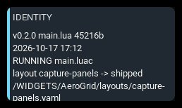
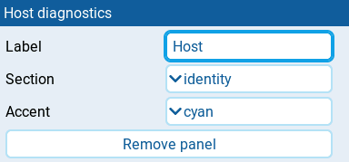

# Host diagnostics

Displays facts read from the running AeroGrid host: loaded files, theme,
panel failures, or source bindings. This diagnostic panel is for developers
and users investigating a dashboard that behaves unexpectedly, rather than
for monitoring a flight.

The panel needs at least 2x2 cells to fit its rows.

## Settings

| Setting | Default | What it does |
| --- | --- | --- |
| **Label** | section name | Panel heading. Clear it to use the selected **Section**. |
| **Section** | identity | Report to show: **identity**, **theme**, **panels**, or **sources**. |
| **Accent** | cyan | Panel accent: **cyan**, **green**, **amber**, or **orange**. Diagnostic messages do not change the panel color. |
| **Remove panel** | | Deletes the panel from the screen. |

## Behavior

**identity** reports the package version, main script size and modification
time when available, whether compiled bytecode is present, the layout selection
and resolved path, and the model filename. `RUNNING main.luac` warns that
EdgeTX can prefer the compiled file over the source; the source timestamp
alone does not prove which code is executing.

**theme** reports the resolved theme, where its selection came from, any fallback
from a requested theme, and host notices. **panels** reports the panel count,
failure count, and each panel's identifier, type, and span. Rejected and failed
panels appear before healthy ones, with their error text.

**sources** reports the shared telemetry subscriptions: the requested source
names, binding identifiers and states. Unbound sources appear first. An unbound
name may be misspelled or absent on the radio; the report cannot distinguish
the two.

Reports read the live host context rather than resolving the layout or theme
again. Lines are left-aligned and refresh about twice per second. The panel
shows only the lines that fit, up to twelve; enlarge it to reveal more. Long
reports can still extend beyond that limit.

## States

| Condition | Presentation |
| --- | --- |
| Report available | Diagnostic lines with the normal **Accent**; no alarm badge. |
| Main script cannot be inspected | `main.lua unreadable` alongside the package version; other identity lines still appear. |
| Compiled main script present | `RUNNING main.luac` near the top of the identity report. |
| Panels rejected or failed | Failure count and `REJECTED` or `FAILED` lines before healthy panels; normal panel colors remain. |
| Sources cannot bind | Unbound count and source names marked `UNBOUND` before bound sources. |
| No theme, panels, telemetry service, or subscriptions | `no theme`, `no panels`, `no telemetry service`, or `no sources subscribed` in the corresponding report. |
| Host unavailable or section unrecognized | `no host` or `no section` followed by the requested section. |
| Report raises an error | `report failed:` followed by the error text. |
| Report exceeds available space | Trailing lines are hidden; no warning badge is added. |
