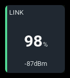
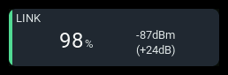
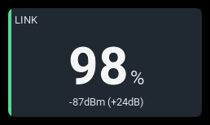
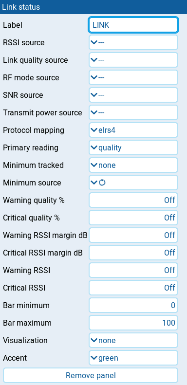

# Link status

| 1x2 | 2x1 | 2x2 |
| --- | --- | --- |
|  |  |  |

Shows measured link quality or RSSI, link freshness, and optional RF details.
Link quality is never inferred from RSSI. The panel does not calculate an
aggregate health percentage or issue voice or haptic alerts.

## Settings

| Setting | Default | What it does |
| --- | --- | --- |
| **Label** | LINK | Panel heading. |
| **RSSI source** | RSSI | Signal-strength source, such as `RSSI` or receiver-side `1RSS`. |
| **Link quality source** | none | Measured link-quality source, such as receiver-side `RQly`. Quality alarms require a source reporting percent. |
| **RF mode source** | none | RF mode source, such as `RFMD`. Enables rate decoding and margin calculation with **Protocol mapping** set to **elrs4**. |
| **SNR source** | none | Optional signal-to-noise reading, such as `RSNR`. It does not trigger alarms. |
| **Transmit power source** | none | Optional transmit-power reading, such as `TPWR`. It does not trigger alarms. |
| **Protocol mapping** | generic | **generic** preserves source units and the raw RF mode. **elrs4** decodes ExpressLRS 4.x RF modes and estimates RSSI margin above nominal receiver sensitivity. |
| **Primary reading** | auto | **rssi** or **quality** selects the headline. **auto** prefers available quality, including a retained stale reading, and falls back to RSSI. |
| **Minimum tracked** | none | **none** shows the other reading as supporting detail. **source** shows an EdgeTX minimum; **flight** shows the dashboard's session minimum. |
| **Minimum source** | automatic | Explicit EdgeTX minimum source for **Minimum tracked** set to **source**. With none selected, uses the tracked source's minimum, such as `RSSI-`. |
| **Warning quality %** | Off | Low-quality warning threshold, 0 to 100 percent. Steps of 1. Requires **Link quality source**. |
| **Critical quality %** | Off | Low-quality critical threshold, 0 to 100 percent. Steps of 1. Requires **Link quality source**. |
| **Warning RSSI margin dB** | Off | Low-margin warning threshold, 0 to 60 dB. Steps of 1. Requires **Protocol mapping** set to **elrs4**, **RSSI source**, and **RF mode source**. |
| **Critical RSSI margin dB** | Off | Low-margin critical threshold, 0 to 60 dB. Steps of 1. Requires **Protocol mapping** set to **elrs4**, **RSSI source**, and **RF mode source**. |
| **Warning RSSI** | Off | Low-RSSI warning threshold in the source's units, −130 to 100. Steps of 1. Requires **RSSI source**. |
| **Critical RSSI** | Off | Low-RSSI critical threshold in the source's units, −130 to 100. Steps of 1. Requires **RSSI source**. |
| **Bar minimum** | 0 | Primary-reading value at which the bar is empty, in the source's units. Steps of 1. |
| **Bar maximum** | 100 | Primary-reading value at which the bar is full, in the source's units. Steps of 1. |
| **Visualization** | bar | **bar** shows the primary reading's level; **none** hides it. |
| **Accent** | green | Color used for the normal state: **cyan**, **green**, **amber**, or **orange**. Alarm and stale states use the shared state colors instead. |

The six alarm thresholds start at **Off**; step below the lowest value to
turn one off again.
Each critical threshold must be less than or equal to its warning threshold.

## Behavior

Link quality shows packet reception; RSSI shows signal strength, with
less-negative dBm values indicating a stronger signal. Both sources remain
active regardless of **Primary reading**. The other reading or the selected
minimum appears as supporting detail where space permits.

With **Protocol mapping** set to **elrs4**, live RSSI and RF mode readings can
show the RF rate and estimated signal margin. RSSI must be nonpositive and
reported in dB or dBm, and RF mode must be a recognized, unitless value.
Margin is headroom above nominal receiver sensitivity, not a guaranteed
failsafe boundary. Dual-band modes and unavailable or stale inputs show no
margin. Use **generic** for other protocols, including ExpressLRS 3.x.

All thresholds trigger at or below their value. The most severe live alarm
wins, with critical ahead of warning. Equal-severity conditions prefer RSSI,
then link quality, then margin. Link-down takes precedence over alarms.
Link-quality thresholds only apply to a source reporting percent.

**Minimum tracked** set to **source** reads EdgeTX's own minimum, which EdgeTX
resets on its own schedule. **Minimum source** overrides the automatic source.
**flight** resets the minimum when the dashboard's arm switch becomes active,
tracks fresh readings while armed, and retains the result after disarming.
That switch is set in the layout file; see the YAML reference. With no arm
switch configured, it tracks one open-ended dashboard session instead.
The tracked source is **RSSI source** when **Primary reading** is **rssi**;
otherwise it is **Link quality source**, falling back to **RSSI source** when
no quality source is selected. It does not switch with the automatic headline.

## States

| Condition | Presentation |
| --- | --- |
| Live readings, no crossed thresholds | Measured value and normal accent. |
| Low link quality, RSSI, or margin | `WARN` or `CRIT` badge, state color, and the cause where supporting text fits. |
| Link down after the primary has received data | `NO LINK` headline without a unit, critical state, and empty bar. |
| Link down before the primary has received data | Unavailable state rather than a critical alarm. |
| Stale primary source | Last reading retained and `STALE`; an independent live warning or critical alarm can take precedence. |
| Primary source not recognized | `N/A` reading and badge, empty bar. |
| Primary source waiting for data or not selected | `--` reading and `N/A` badge, empty bar. |
| Minimum unavailable | `MIN --` or a shorter form where supporting detail fits. |
| Valid zero while live | Measured zero, not an unavailable sentinel. |
