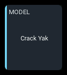
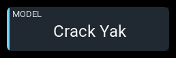
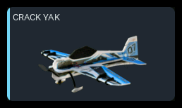
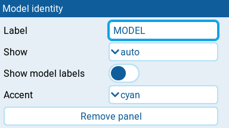

# Model identity

| 1x2 | 2x1 | 2x2 |
| --- | --- | --- |
|  |  |  |

Shows the loaded model's name, its assigned picture, and optionally its model
labels. The information comes from EdgeTX, not telemetry.

## Settings

| Setting | Default | What it does |
| --- | --- | --- |
| **Label** | MODEL | Panel heading when no picture is drawn. With a picture, the model name becomes the heading. A custom label cannot be combined with **Show** set to **image** or **both**; the default MODEL is allowed. |
| **Show** | auto | **name** requests the model name alone. **image** and **both** request a picture with the name in the heading. **auto** requests the name below four grid cells and a picture with the name at four or more. |
| **Show model labels** | off | Shows the model's configured labels in a supporting row where space permits. |
| **Accent** | cyan | Normal accent stripe: **cyan**, **green**, **amber**, or **orange**. |

## Behavior

Assign the model name and picture in EdgeTX Model Setup. The picture scales
to fit without cropping. With a picture, the model name moves into the
heading, where it is fitted and shortened if needed. Without a picture,
**Label** is the heading and the model name is the main reading. A long name
may extend beyond a narrow panel.

No assigned picture or a missing file falls back to the model name. A file
that exists but cannot be decoded may leave the picture area empty; **both**
does not keep a separate body name visible while a picture is drawn.
A picture or model-label row that does not fit is hidden. **auto** and
**both** retain the body name when the picture is hidden for space.

## States

| Condition | Presentation |
| --- | --- |
| Model information available | Model name or picture, normal accent, and no badge. |
| Model information unavailable | `--` and an `N/A` badge. |
| Model name empty | `--`, without an unavailable badge if model information is otherwise available. |
| Picture absent or missing | Model name shown instead, without a failure badge. |

There are no thresholds or telemetry freshness checks, so this panel does not
produce warning, critical, or stale states.
