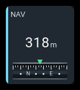
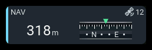
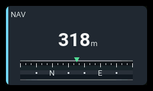
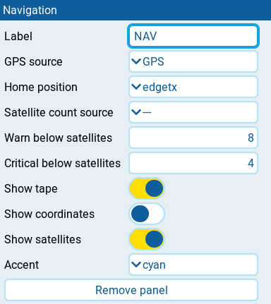

# Navigation

| 1x2 | 2x1 | 2x2 |
| --- | --- | --- |
|  |  |  |

Shows distance from home and the north-up bearing from home toward the model,
with optional GPS coordinates and satellite count. Bearing is not aircraft
heading, transmitter orientation, or a return-home instruction.

## Settings

| Setting | Default | What it does |
| --- | --- | --- |
| **Label** | NAV | Panel heading. |
| **GPS source** | GPS | EdgeTX GPS source supplying the model's coordinates. It must return a coordinate table. |
| **Home arm switch** | none | With no switch selected, uses EdgeTX home. Selecting an armed physical switch position or logical switch enables first-arm home capture. |
| **Satellite count source** | none | Optional source reporting a plain nonnegative integer count of locked satellites, not a packed GPS-status value. |
| **Warn below satellites** | 8 | Warns when the satellite count is strictly below this value. Nonnegative integers, steps of 1. Requires **Satellite count source**. |
| **Critical below satellites** | 4 | Critical alarm when the satellite count is strictly below this value. Nonnegative integers, steps of 1; must not exceed **Warn below satellites**. Requires **Satellite count source**. |
| **Show tape** | off | Replaces bearing text with a scrolling direction tape where space permits. |
| **Bearing format** | degrees | **degrees** shows numeric azimuth; **quadrant** shows notation such as `N29°E`. Shown only when **Show tape** is off. |
| **Show coordinates** | off | Shows the model's latitude and longitude where space permits, independently of **Show tape**. |
| **Show satellites** | on | Shows the satellite icon and locked-satellite count in the header where space permits. Requires **Satellite count source**; turning it off does not disable satellite alerts. |
| **Accent** | cyan | Color used for the normal state: **cyan**, **green**, **amber**, or **orange**. Alarm and stale states use the shared state colors instead. |

## Behavior

Distance from home is always the main reading. It uses metres or kilometres
according to distance. Zero latitude and longitude together mean no fix,
matching EdgeTX's uninitialized GPS values. A valid `0m` reading means the
model is at home, not that GPS is unavailable.

### Satellite count and alerts

With **Satellite count source** selected, **Show satellites** controls the
satellite icon and locked-satellite count in the header. It defaults to on,
including for existing layouts without this setting. Turning it off hides
both the icon and count, not the warning, critical, missing-source, or stale
indications. The indicator is also hidden when it cannot fit; alerts remain active.
With no source selected, neither the indicator nor satellite alerts appear.
The defaults make 0 critical, 4 warning, and 8 normal. Thresholds do not
control home capture, and distance never triggers an alarm.

### First-arm home

With **Home arm switch** unset, home comes from EdgeTX.
Selecting an armed position captures a separate AeroGrid home without
changing EdgeTX home or the flight controller's return-home position.
AeroGrid must observe disarmed, then armed; opening the widget already armed
does not capture home.

With a configured **Home arm switch**, AeroGrid captures the home position when
the model is first armed. If that capture fails, each later disarm and re-arm
tries again until home is set.

A captured home or failed attempt survives telemetry loss, panel recreation,
and layout or theme reloads in this widget instance. Panels using the same
GPS source and armed switch share the capture. A different pair has its own
capture. Home is not saved to disk: restarting the radio, reloading the model,
or removing and recreating the widget starts a new session. Separate widget
instances have independent homes.

To investigate `HOME NOT SET`, first add a **Host diagnostics** panel and
select its **log** section on any AeroGrid screen. The shared in-memory log
records captured/missed or switch unavailable, together with the inputs used
for the decision: current time, availability, freshness, stale state, value,
update time, reported delay, and coordinate validity. These are GPS inputs
for capture attempts, or switch inputs for switch-unavailable events.
Times are 10 ms ticks; GPS delay is seconds. Poll age is
`now - updatedAt`; combined age is `delay * 100 + now - updatedAt`.
Missing values appear as `nil`. No coordinates are logged.
The capture gates and first-transition-only timing are unchanged. The log
cannot recover an attempt made before logging was enabled; reproduce it in a
new widget session. See [Host diagnostics](host-diagnostics.md#shared-log) for
retention settings and the fullscreen history viewer.

### Bearing display

**Show tape** places the tape below distance in square and tall panels, and
beside it in wide panels. Resizing updates this arrangement. It spans 210
degrees beneath a fixed pointer, with `N`, `E`, `S`, and `W` labels, major
ticks every 30 degrees, and minor ticks every 10 degrees. Its tint follows
the panel state. When bearing is unavailable, the tape shows the reason
instead of a pointer and scale that could imply due north.

With **Show tape** off, **Bearing format** selects numeric azimuth or
quadrant notation. Bearing text and **Show coordinates** are displayed only
where they fit; a tape that cannot fit yields to distance. Stale data retains
the last bearing with the panel's `STALE` indication.

### Location details

In fullscreen, tap the panel to open a QR code linking to Google Maps at the
model's GPS coordinates, not home. The code and coordinates are frozen when
opened; close and reopen for a newer position. A stale fix is marked
`LAST KNOWN POSITION`. Without a valid position, tapping does nothing.

Tap anywhere or press **RTN/Back/Exit** to return. Location details are
unavailable outside fullscreen and while editing. The radio generates the
QR code without a network connection; following it on a phone uses Google Maps.

## States

| Condition | Presentation |
| --- | --- |
| Valid fix and home | Distance, live bearing, and requested coordinates. |
| GPS source not recognized | `--`, `N/A` badge, and `NO GPS SOURCE` or a shorter form where supporting text fits. |
| Source present but no fix | `--`, `N/A` badge, and `NO FIX` where supporting text fits, unless a satellite alarm takes precedence. |
| Valid fix but no EdgeTX home | No distance or bearing; requested coordinates remain available. `NO HOME POSITION` or a shorter form, without a failure badge. |
| Waiting for the first arm with a valid fix | No distance or bearing; `WAITING FOR ARM` or a shorter form. |
| First-arm capture missed with a valid fix | No distance or bearing; `HOME NOT SET` or a shorter form. |
| Home arm switch unreadable with a valid fix before capture | No distance or bearing; `ARM SWITCH UNAVAILABLE` or a shorter form. |
| Stale position | Last reading retained, `STALE` badge, and `LAST KNOWN` or a shorter form where supporting text fits. |
| Configured satellite count below a threshold | `WARN` or `CRIT` badge and state color, even while waiting for a fix or home. |
| Configured satellite source missing or invalid | `N/A` badge and satellite count `--` when **Show satellites** is on and it fits. GPS readings remain available. |
| Configured satellite count stale | Last count retained and `STALE` badge. |

Satellite critical is checked before warning, using strict less-than
comparisons. An unrecognized GPS source, stale position, or missing, invalid,
or stale satellite count takes priority over satellite threshold alarms.
