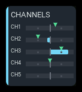
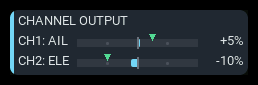
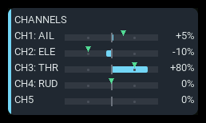
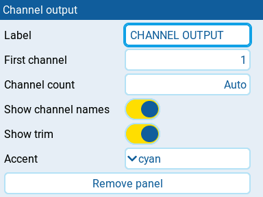

# Channel output

| 1x2 | 2x1 | 2x2 |
| --- | --- | --- |
|  |  |  |

Displays the radio's final channel outputs, after output limits and reversal.
No aircraft telemetry is required.

## Settings

| Setting | Default | What it does |
| --- | --- | --- |
| **Label** | CHANNEL OUTPUT | Panel heading. Clear it to restore the default. |
| **First channel** | 1 | First channel to show, from 1 to 32. Steps of 1. |
| **Channel count** | Auto | Number of consecutive channels to show, from 1 to 32. Step below 1 to return to **Auto**, which fills the available rows. |
| **Show channel names** | on | Show up to three letters of the channel name when space permits. |
| **Show trim** | on | Show the corresponding effective stick-trim arrow when it can be identified. |
| **Accent** | cyan | Color used for the normal state and output fill: **cyan**, **green**, **amber**, or **orange**. |

## Behavior

Channels appear consecutively starting at **First channel**. With
**Channel count** on **Auto**, the panel fills the available rows; a chosen count is capped by the
available space and CH32. The panel adjusts when resized. Wide panels show
signed output percentages beside the tapes; narrow panels keep the tapes.

**Show channel names** and **Show trim** are independent. Hiding names leaves
just the channel number and more room for the tape. Hiding trims removes the
green arrows without changing output readings.

Channel names come from the model's Outputs page. When an output is unnamed,
the panel uses its enabled mix name, Input name, input-line name, or source
name, in that order. Conflicting names from active mixes are omitted rather
than guessed. Up to three letters follow the channel number, such as
`CH1: AIL`, and disappear when they will not fit. Side-by-side rows omit
names unless at least 64 pixels remain for the tape.

A green downward arrow shows the corresponding effective stick trim, not
output subtrim or the trim's calculated contribution to servo travel. Its
scale starts at standard trim travel and widens to extended travel once an
extended value is observed. An ambiguous or unavailable trim has no arrow.

## States

| Condition | Presentation |
| --- | --- |
| At least one visible output is readable | Output tapes and normal accent. Percentages appear when space permits. |
| An output is unreadable | Its value is `--` where values are shown; its fill and trim arrow are hidden. |
| No visible output is readable | `N/A` badge. |
