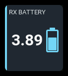
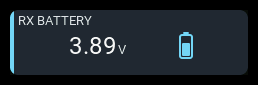
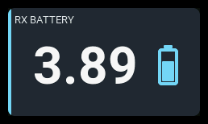

# `rx-battery`

| 1x2 | 2x1 | 2x2 |
| --- | --- | --- |
|  |  |  |

Displays aircraft-battery voltage from either an EdgeTX **cells monitor** or
a numeric **pack-voltage sensor**, such as `RxBt`. The source must actually
measure the flight battery; regulated receiver supply voltage does not reveal
pack voltage.

The headline always shows two decimals. This is display precision, not a
promise of sensor accuracy or resolution. The panel does not infer remaining
capacity from voltage.

## Settings

| Setting | Default | Meaning |
| --- | --- | --- |
| `label` | `PACK` | Panel heading. |
| `source` | `Cels` | Exact EdgeTX source name; tables are individual cells, numbers are pack voltage. |
| `reading` | `cell` | `cell` or `pack`. A cell reading is the table's lowest cell in cells mode and the calculated average in pack mode. |
| `showPack` | `true` | **Show alt reading**: show pack voltage when cell voltage is primary, or average cell voltage when pack voltage is primary. A preference, shown only when it fits; ignored by the `battery` visualization. |
| `showCount` | `true` | Show the cells-monitor count or the pack's configured/estimated series count. A preference, shown only when it fits; ignored by the `battery` visualization. |
| `showDelta` | `false` | **Show cell delta**: highest minus lowest individual cell voltage, formatted `Δ 0.01v`. Only valid cells tables can supply it; numeric voltage reserves no delta slot. |
| `cells` | `0` | Numeric sources only: `0` estimates series count; 1–16 sets it explicitly. Tables supply their own count and ignore this setting. |
| `cellFull` | `4.2` | Full usable-range voltage, in V/cell. |
| `cellWarning` | `3.6` | Warning threshold, in V/cell. |
| `cellCritical` | `3.4` | Critical threshold, in V/cell. |
| `cellEmpty` | `3.2` | Empty usable-range voltage, in V/cell. |
| `visual` | `battery` | **Visualization**: `battery`, `bar`, or **details** (stored as `none`). The battery and bar measure voltage against the usable per-cell range, not remaining charge. |
| `accent` | `cyan` | Semantic accent: `cyan`, `green`, `amber`, or `orange`. |

The flat editor drawer presents **Label**, **Voltage source**, **Cell count
(0 = auto)**, **Primary reading**, **Visualization**, **Show alt reading**,
**Show cell count**, and **Show cell delta**, in that order. Series count remains
editable without telemetry and is ignored when the source returns a table. Voltage levels
are grouped under **Voltage levels**, in Full, Warning, Critical, Empty order,
with V/cell shown in each label. Full and Empty are hidden while visualization is
**details**. All three supporting-detail toggles are hidden
while visualization is **battery**, because that visualization never shows
them; their stored values are kept.

Voltage levels must be coherent: **Full > Warning >= Critical >= Empty**.
Unknown settings and invalid threshold ordering are rejected. Panel size never
makes the alternate-reading or cell-count toggles invalid: details that do not
fit are dropped quietly (see [Visualization and details](#visualization-and-details)).

### Layout schema and migration

Current layout files use schema version 3. For example:

```yaml
version: 3
grid:
  columns: 4
  rows: 4
panels:
  - id: flight-pack
    type: rx-battery
    col: 0
    row: 0
    colSpan: 2
    rowSpan: 2
    config:
      label: RX battery
      source: RxBt
      cells: 0
      reading: cell
```

Layouts are upgraded **in memory** before panel validation/loading.
Explicit voltage levels are preserved; omitted values use the defaults above.
A brief upgrade notice explains
that the migrated layout is not yet saved. Loading never overwrites a layout:
use the editor's explicit **Save** action to persist it as version 2. Newer or
malformed layout versions are rejected rather than interpreted with older
assumptions.

The central migration registry has one adjacent helper per layout version for
both headers and panels. Runtime loading and staged Save apply at most one
transition per callback, so future upgrades do not require an unbounded pass
through the migration chain in a single callback.

## Behavior

Source shape is detected automatically, never guessed from voltage magnitude.
A **cells table** supplies
the cell count and pack sum. A `cell` headline uses the lowest valid cell;
alarms always judge that lowest cell, even when `reading: pack` is selected.

A **numeric source** supplies total pack voltage. With
`cells: 1`–`16`, the panel calculates average cell voltage from pack voltage
and series count. With `cells: 0`, it estimates count by dividing the first
fresh, valid pack voltage by `cellFull` and rounding to the nearest integer.
The count is held for that telemetry connection rather than recalculated as
voltage falls; after a disconnect, the next fresh reading starts a new
estimate. An estimated count is marked `EST`. Estimation assumes the first
reading is near full, so starting the radio mid-flight, a partly charged pack,
load sag, or an unusual chemistry can produce the wrong count. Configure the
known series count when possible. Pack voltage cannot reveal a weak or
unbalanced cell, so alarms judge only its calculated average.

All four voltage levels are in **volts per cell**. The battery/bar spans
`cellEmpty` to `cellFull`; alarm thresholds are separate. `cellCritical` is checked
before `cellWarning`. A pack headline is total voltage, while its fill is still
normalized using average volts per cell.

### Visualization and details

The cell count, cell delta and secondary reading are supporting details. They are shown
only when they fit beside or below the headline without crowding it, and are
dropped otherwise rather than reported as a settings problem.

- **battery** draws the battery glyph and never shows any supporting
  reading, at any panel size, so the glyph and headline get the space.
- **bar** draws the usage bar and adds details that fit, in priority order:
  count, then cell delta, then secondary reading. Secondary is shed first,
  then delta, and count last. Both footer and side stack are tried before
  dropping the next lowest-priority detail.
  If delta cannot fit alongside the count in either placement, a shorter
  secondary reading can still use the remaining room.
- **details** (`none`) draws no glyph or bar. It shows the alternate
  enabled available details as text, with the same priority, either in a footer
  row or, on short wide panels, stacked beside the headline.

The delta glyph uses EdgeTX's native `CHAR_DELTA` character (the font's custom
U+0088 mapping). The firmware fonts do not require a Unicode Greek-block glyph.

Small panels usually retain only the headline; fit is measured, not span-gated.
Count-row wordings such as `NO CELLS`,
`CELLS ERR`, and `VOLT ERR` use the count slot, so they appear in **bar** and
**details** whenever that slot fits, even with `showCount` off.

## States

| State | Condition | Presentation |
| --- | --- | --- |
| `normal` | Valid, fresh judged voltage above `cellWarning` | Reading and visual in their normal colors. |
| `warning` | Judged voltage at or below `cellWarning` | Amber state color, tinted panel, `WARN` badge. |
| `critical` | Judged voltage at or below `cellCritical` | Red state color, tinted panel, `CRIT` badge. |
| `stale` | Retained reading whose source is stale | Last voltage retained, muted presentation, `STALE` badge. |
| `unavailable` | No usable headline | `--`, no unit or battery glyph, `N/A` badge. |

An empty table shows `NO CELLS`; an unusable table shows `CELLS ERR`. Invalid numeric voltage
shows `VOLT ERR` (in the count slot, when shown). Before any reading arrives,
the count row is blank.

## Examples

Cells monitor:

```yaml
- id: monitored-pack
  type: rx-battery
  col: 0
  row: 0
  colSpan: 2
  rowSpan: 2
  config:
    source: Cels
    reading: cell
    visual: bar
    showDelta: true
```

Pack-voltage source with an explicit series count:

```yaml
- id: flight-pack
  type: rx-battery
  col: 0
  row: 0
  colSpan: 2
  rowSpan: 2
  config:
    source: RxBt
    cells: 4
    reading: cell
```
