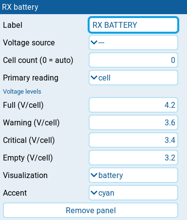

# RX battery

| 1x2 | 2x1 | 2x2 |
| --- | --- | --- |
|  |  |  |

Displays aircraft-battery voltage from an EdgeTX cells monitor or a numeric
pack-voltage source such as `RxBt`. The source must measure the flight battery;
regulated receiver supply voltage does not reveal pack voltage. The headline
shows two decimals, not a promise of sensor accuracy or resolution.

## Settings

| Setting | Default | What it does |
| --- | --- | --- |
| **Label** | PACK | Panel heading. |
| **Voltage source** | Cels | EdgeTX source supplying individual cells or total pack voltage. The panel detects which kind of reading it receives. |
| **Cell count (0 = auto)** | 0 | Series count for a numeric pack source: 0 estimates it; 1 to 16 sets it explicitly. Steps of 1. Cells monitors supply their own count and ignore this setting. |
| **Primary reading** | cell | **cell** shows the lowest monitored cell, or the calculated average for a numeric pack source. **pack** shows total pack voltage. |
| **Voltage levels** | | Per-cell voltage settings. |
| **Full (V/cell)** | 4.2 | Full end of the battery or bar scale, and the voltage used to estimate series count. 0 to 10, in steps of 0.01. Shown only when **Visualization** is **battery** or **bar**. |
| **Warning (V/cell)** | 3.6 | Warning at or below this per-cell voltage. 0 to 10, in steps of 0.01. |
| **Critical (V/cell)** | 3.4 | Critical at or below this per-cell voltage, taking priority over warning. 0 to 10, in steps of 0.01. |
| **Empty (V/cell)** | 3.2 | Empty end of the battery or bar scale. 0 to 10, in steps of 0.01. Shown only when **Visualization** is **battery** or **bar**. |
| **Visualization** | battery | **battery** draws a battery glyph; **bar** draws a voltage bar; **details** shows readings without either visual. |
| **Show alt reading** | on | Requests pack voltage when **Primary reading** is **cell**, or average cell voltage when it is **pack**. Shown only when **Visualization** is **bar** or **details**. |
| **Show cell count** | on | Requests the measured, configured, or estimated series count. Shown only when **Visualization** is **bar** or **details**. |
| **Show cell delta** | off | Requests highest minus lowest individual cell voltage. Only a cells monitor with no rejected cell readings can supply it. Shown only when **Visualization** is **bar** or **details**. |
| **Accent** | cyan | Color used for the normal state: **cyan**, **green**, **amber**, or **orange**. Alarm and stale states use the shared state colors instead. |

## Behavior

A cells monitor supplies its own count and pack sum. Alarms judge the lowest
valid cell, even when **Primary reading** is **pack**. Invalid cell entries
are excluded from the sum and count; **Show cell delta** supplies no reading
if any entries were rejected.

A numeric source supplies total pack voltage. The panel divides it by
**Cell count (0 = auto)** to calculate average cell voltage. With an automatic
count, the first fresh, valid voltage is divided by **Full (V/cell)** and
rounded to the nearest integer. That estimate is held as voltage falls;
after stale or missing data, the next fresh reading starts a new estimate.
The count is marked `EST`, shortened to `~` or omitted when space is tight.
Estimation assumes the first reading is near full. A partly charged pack,
load sag, starting mid-flight, or a different chemistry can give the wrong
count. Set the known series count when possible. Pack voltage cannot reveal
a weak or unbalanced cell, so alarms judge only its calculated average.

All four voltage levels are in volts per cell. **Full (V/cell)** must be above
**Warning (V/cell)**, which must be at or above **Critical (V/cell)**, which
must be at or above **Empty (V/cell)**. These constraints still apply when
**Visualization** is **details**. Thresholds include the boundary value,
and critical takes priority.

The battery and bar are empty at **Empty (V/cell)** and full at
**Full (V/cell)**. For a pack headline, fill uses average cell voltage;
for a monitored cell headline, it uses the lowest cell. This is voltage
headroom, not remaining capacity. Values outside the range keep the visual
empty or full while the number still shows the actual voltage.

### Visualization and details

**battery** never shows supporting readings. **bar** and **details** show
enabled, available details only when they fit: cell count has priority over
cell delta, which has priority over the alternate reading. Both a footer
and a side stack are tried before details are dropped. If delta cannot fit,
a shorter alternate reading can still use the remaining room.

**Show cell delta** displays the difference to two decimals with a delta
symbol. **Show alt reading** displays pack voltage to one decimal, or
average cell voltage to two decimals. Captions shorten when needed. Small
panels may retain only the headline; enlarging the panel restores details
when they fit.

## States

| Condition | Presentation |
| --- | --- |
| Fresh judged voltage above the warning threshold | Reading and visual in their normal colors. |
| Judged voltage at or below **Warning (V/cell)** | Amber state color, tinted panel, `WARN` badge. |
| Judged voltage at or below **Critical (V/cell)** | Red state color, tinted panel, `CRIT` badge; critical takes priority. |
| Retained reading becomes stale | Last voltage retained, muted presentation, `STALE` badge. |
| No usable headline | `--`, no unit or battery glyph, `N/A` badge. |
| Empty cells table | `NO CELLS` in the count slot when it fits in **bar** or **details**. |
| No valid cells, or a malformed nonnumeric reading | `CELLS ERR` in the count slot when it fits in **bar** or **details**. |
| Invalid numeric pack voltage or unusable series count | `VOLT ERR` in the count slot when it fits in **bar** or **details**. |
| No reading has arrived | Count row is blank. |

Error wordings use the count slot even when **Show cell count** is off.
