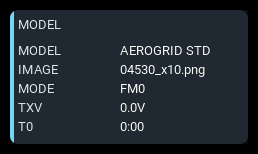
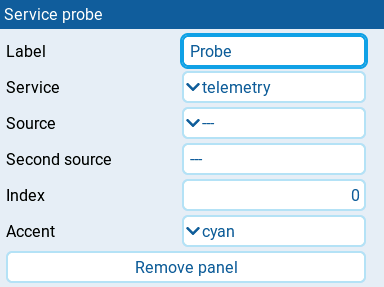

# Service probe

Displays label-and-value rows from one shared AeroGrid data service.
This developer diagnostic panel helps check normalized values, units,
precision, availability, and navigation calculations independently of the
flight panels that use them.

The panel needs at least 2x2 cells to fit its rows.

## Settings

| Setting | Default | What it does |
| --- | --- | --- |
| **Label** | service name | Panel heading. Clear it to use the selected **Service**. |
| **Service** | telemetry | Service to inspect: **telemetry**, **model**, **control**, **extrema**, or **navigation**. |
| **Source** | none | EdgeTX source picker. Select the reading for **telemetry**, GPS source for **navigation**, trim source for **control**, or reading to track for **extrema**. Unused by **model**. |
| **Second source** | none | Arming source name for **extrema** flight-session tracking. Enter the source name as text, not through a picker; positive numeric values mean armed. Unused by the other services. |
| **Index** | 0 | Zero-based timer index for **model** (0 to 2) or global variable index for **control** (0 to 8). Unused by the other services. The number control steps by 1 from -100000 to 100000, not just the useful index range, and has no empty option. |
| **Accent** | cyan | Panel accent: **cyan**, **green**, **amber**, or **orange**. Reported service states do not change the panel color. |
| **Remove panel** | | Deletes the panel from the screen. |

All settings remain visible for every **Service**, including those it does not
use.

## Behavior

**telemetry** reports the selected source name, state, formatted value, unit,
precision, reading age, and link status. **navigation** reports the GPS source,
fix and home availability, latitude, longitude, distance, and bearing.

**model** requests model identity, flight mode, transmitter voltage, and the
selected timer. **control** requests the selected trim, when **Source** is not
empty, and the selected global variable in the current flight mode.
**extrema** requests shared flight-session status and, when **Source** is not
empty, session minimum and maximum values for that source. These three services
report shared subscriptions, so rows requested by other panels can appear too.

For **extrema**, the first nonempty arming source configured for the shared
service wins. **Second source** cannot override an already configured source.
Without one, the service tracks an open-ended session. This is diagnostic
shared-session tracking, not the flight counter panel's own flight detection.

Rows are left-aligned in two columns and refresh about twice per second.
Only the rows that fit are shown, up to eight. Enlarge the panel to reveal
more; any remaining rows are omitted. Service state text is diagnostic output,
not a panel alarm or stale badge.

## States

| Condition | Presentation |
| --- | --- |
| Service available | The service's diagnostic rows with the normal **Accent**. |
| Telemetry reading stale or unavailable | State and value reported in the diagnostic rows; panel colors remain normal. |
| No navigation fix or home | `NO` in the corresponding rows; missing coordinates, distance, or bearing show `-`. |
| Model or control reading unavailable | `N/A` or the service's unavailable timer text in the affected row. |
| No tracked extrema available | `N/A` in the affected source row; flight and arming status remain separate rows. |
| Service missing | Uppercase service name with `UNAVAILABLE`; no unavailable badge. |
| Subscription fails | Empty report area; the panel does not display the subscription error. |
| Service returns no rows | Empty report area beneath the heading. |
| Report exceeds available space | Trailing rows are hidden; no warning badge is added. |
