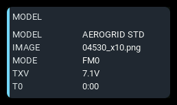
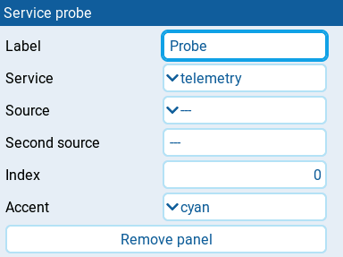

# Service probe

Helps investigate readings supplied to panels by AeroGrid's data services.
Use it to check values, units, availability, and navigation data.

The panel needs at least 2x2 cells to fit its rows.

## Settings

| Setting | Default | What it does |
| --- | --- | --- |
| **Label** | service name | Panel heading. Clear it to use the selected **Service**. |
| **Service** | telemetry | Service to inspect: **telemetry**, **model**, **control**, or **navigation**. |
| **Source** | Not set | EdgeTX source picker. Select the reading for **telemetry**, GPS source for **navigation**, or trim source for **control**. Unused by **model**. |
| **Index** | 0 | Zero-based timer index for **model** (0 to 2) or global variable index for **control** (0 to 8). Unused by the other services. |
| **Accent** | cyan | Normal panel accent. Reported service states do not change it. |

All settings remain visible for every **Service**, including those it does not
use.

## Behavior

Rows refresh about twice per second. Up to eight rows are shown, limited by
panel size; enlarge the panel to reveal more. Diagnostic state text does not
change the panel's colors.

### Telemetry

Select **telemetry** to inspect the chosen source's value, unit, precision,
age, availability, and link status.

### Model

Select **model** to inspect model identity, flight mode, transmitter voltage,
and the timer chosen by **Index** (0-2).

### Control

Select **control** to inspect the trim chosen by **Source** and the global
variable chosen by **Index** (0-8) in the current flight mode.

### Navigation

Select **navigation** to inspect the GPS source, fix and home availability,
coordinates, distance, and bearing.

Model and control reports can also include readings requested by other panels.

## States

| Condition | Presentation |
| --- | --- |
| Service available | The service's diagnostic rows with the normal **Accent**. |
| Telemetry reading stale or unavailable | State and value reported in the diagnostic rows; panel colors remain normal. |
| No navigation fix or home | `NO` in the corresponding rows; missing coordinates, distance, or bearing show `-`. |
| Model or control reading unavailable | `N/A` or the service's unavailable timer text in the affected row. |
| Service missing | Uppercase service name with `UNAVAILABLE`; no unavailable badge. |
| Subscription fails | Empty report area; the panel does not display the subscription error. |
| Service returns no rows | Empty report area beneath the heading. |
| Report exceeds available space | Trailing rows are hidden; no warning badge is added. |
