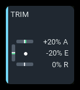
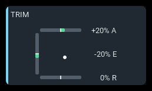
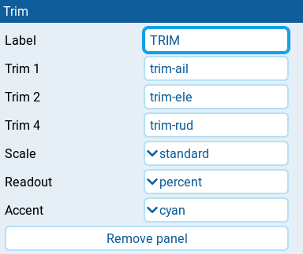

# Trim

| 1x2 | 2x1 | 2x2 |
| --- | --- | --- |
|  |  |  |

Displays the radio's effective aileron, elevator, and rudder trim positions,
including values inherited from another flight mode. The panel is read-only;
use the radio's trim controls to change a trim. No aircraft telemetry is needed.

## Settings

| Setting | Default | What it does |
| --- | --- | --- |
| **Label** | TRIM | Panel heading. |
| **Trim 1** | trim-ail | Trim source shown as aileron on the top bar. Enter its EdgeTX source name as text, such as `trim-ail`. |
| **Trim 2** | trim-ele | Trim source shown as elevator on the left bar. Enter its EdgeTX source name as text, such as `trim-ele`. |
| **Trim 4** | trim-rud | Trim source shown as rudder on the bottom bar. Enter its EdgeTX source name as text, such as `trim-rud`. |
| **Scale** | auto | **auto** starts with standard travel and widens to extended travel when needed. **standard** or **extended** keeps the range fixed. |
| **Readout** | percent | **percent** shows signed percentages; **raw** shows stored trim units; **none** hides numeric readouts. Detected three-position trims show named positions instead of numbers. |
| **Accent** | cyan | Panel accent: **cyan**, **green**, **amber**, or **orange**. Available trim fills stay green. |

## Behavior

Aileron is the top bar, elevator the left bar, and rudder the bottom bar.
Fill extends from neutral toward the current trim. The white dot shows the
combined aileron/elevator position and disappears if either source is
unavailable. Source names can change, but the positions and `A`, `E`, and `R`
readout suffixes retain their assigned roles.

**Readout** uses percentages of the selected scale, or stored trim units for
**raw**. Standard travel is ±128 stored units; extended travel is ±512.
**auto** widens each trim's scale once a non-three-position reading exceeds
standard travel, and keeps that wider scale even when the trim returns toward
center. A fixed scale clips the visual at its ends without changing the raw
readout.

Three-position trims show `3P MID`, `3P HI`, or `3P LO`. Detection requires
observing both center and full deflection without intermediate positions;
a single end-stop reading cannot distinguish a normal trim from a toggle.
Captions and readouts are hidden when they do not fit and return when the
panel is enlarged.

## States

| Condition | Presentation |
| --- | --- |
| Trim is readable | Green fill from neutral, with a readout when enabled and space permits. |
| Aileron and elevator are readable | White dot shows their combined position. |
| Aileron or elevator unavailable | White dot is hidden. |
| One trim unavailable | Its bar is faint; its readout shows `-- A`, `-- E`, or `-- R` when space permits. Other axes remain active. |
| All three sources unavailable | `N/A` badge; all three bars are faint. |
| Three-position trim detected | `3P MID`, `3P HI`, or `3P LO` replaces its numeric readout. |
