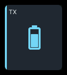
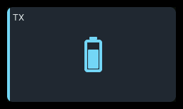

# `tx-battery`

| 1x2 | 2x1 | 2x2 |
| --- | --- | --- |
|  |  |  |

Shows the **transmitter's own** battery — the pack inside the radio in
your hands, not anything on the aircraft.

## Settings

| Key | Type | Default | Values | What it does |
| --- | --- | --- | --- | --- |
| `label` | string | `TX` | any text | The panel's heading. The default is `TX`; a single-cell header has room for about five characters, so `TX BATTERY` needs a wider panel. |
| `accent` | string | `cyan` | `cyan`, `green`, `amber`, `orange` | The stripe down the left edge. Cyan because the palette reserves it for electrical data, and this is a battery. |
| `packEmpty` | number | *the radio's* | volts | Overrides the empty end of the radio's battery meter range. |
| `packFull` | number | *the radio's* | volts | Overrides the full end. |
| `warning` | number | *none* | volts | At or below this, the panel goes `warning`. |
| `critical` | number | *none* | volts | At or below this, the panel goes `critical`. |
| `visual` | string | `battery` | `battery`, `bar`, `none` | `battery` prioritizes the glyph; `bar` adds a bar to voltage; `none` shows voltage without a visual. |
| `showPercent` | boolean | `false` | `true`, `false` | Requests a percentage estimate, shown only where space permits. |

Anything else is rejected at load with the layout, panel and key named.

## Behavior

The battery fill and optional `EST` percentage use the range set in
**SYS → Hardware → Battery meter range**. To override it, set both `packEmpty`
and `packFull`, with full above empty. Incomplete or invalid overrides use
the radio's range. If no range is available, only voltage is shown.

The fill and percentage estimate voltage headroom, not remaining charge.
Choose `visual: battery`, `bar`, or `none`; enable `showPercent` to display
the estimate as text on a panel two rows tall. Details that do not fit are
silently dropped, not reported as configuration warnings. The stored
preferences are preserved, so details return when space permits. This does
not suppress warning, critical, stale or unavailable battery-state badges.
The percentage is centered across the content area as a lone supporting reading.

**Battery mode keeps the glyph first.** All supported spans (`1x1` through
`4x1`, and `1x2` through `4x2`) support it. When the glyph and voltage cannot
fit side by side at the normal reading size, the glyph is centered and the
voltage and unit are hidden. At the standard 480x272 grid size, `1x1` and
`1x2` show the glyph without voltage; wider panels show both. Resizing restores
the voltage automatically when there is room, without shrinking the reading.

To keep numeric voltage in a compact panel, set **`visual: none`**. Existing
compact layouts using the default `battery` now prioritize the glyph instead
of voltage; no new setting is needed. `visual: bar` retains its existing
voltage-first behavior and hides the bar at `1x1`.

Without a usable range, battery mode falls back to numeric voltage rather
than drawing an empty battery that implies zero charge. Without voltage, it
shows `--` and `N/A`, with no glyph or unit. Restoring data or calibration
restores the glyph. Stale readings retain their last level and `STALE` badge.

Set `warning` and `critical` to voltages appropriate for your pack, with
critical below warning. The panel changes color at or below each threshold,
with critical taking priority. No thresholds are set by default.

## States

Battery mode can hide the numeric reading, but the same voltage-derived states,
glyph colors, panel tints and badges still apply.

| State | When | What you see |
| --- | --- | --- |
| `normal` | A voltage above `warning`, or no thresholds stated | The voltage in the reading colour, the whole cell in the accent, no badge |
| `warning` | Voltage at or below `warning` | Amber accent, tinted panel, amber cell, `WARN` badge |
| `critical` | Voltage at or below `critical` | Red accent, tinted panel, red cell throughout, `CRIT` badge |
| `stale` | The radio stopped answering; the last voltage is kept | Muted reading, `STALE` badge |
| `unavailable` | No usable voltage | `--` and an `N/A` badge, no glyph or unit |

## Examples

Compact, glyph-first transmitter battery:

```yaml
- id: tx
  type: tx-battery
  col: 3
  row: 0
  colSpan: 1
  rowSpan: 1
  config:
    label: TX
    visual: battery
    warning: 6.7
    critical: 6.5
```

Change `visual` to `none` for voltage-only presentation in the same slot.

Larger panel with an optional percentage:

```yaml
- id: tx
  type: tx-battery
  col: 0
  row: 0
  colSpan: 2
  rowSpan: 2
  config:
    label: TX
    accent: cyan
    warning: 6.7
    critical: 6.5
    visual: battery
    showPercent: true
```

The voltage appears beside an upright battery, with the percentage beneath
the voltage. No range is stated, so it uses whatever your radio's
battery meter is set to — which is the normal case. Add `packEmpty` and
`packFull` only if you want to override that.
