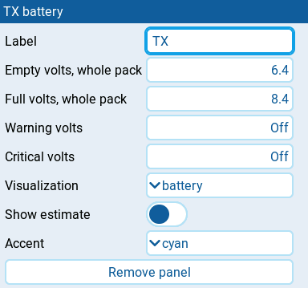

# TX battery

| 1x2 | 2x1 | 2x2 |
| --- | --- | --- |
|  |  |  |

Displays the transmitter's own battery voltage, not the aircraft battery.
An optional battery glyph, bar, and percentage estimate show voltage headroom
against the radio's battery meter range or an explicit override.

## Settings

| Setting | Default | What it does |
| --- | --- | --- |
| **Label** | TX | Panel heading. Longer headings need more space. |
| **Empty volts, whole pack** | Radio | Overrides the empty end of the estimate's range, in whole-pack volts. Takes effect only together with **Full volts, whole pack**, with full above empty. |
| **Full volts, whole pack** | Radio | Overrides the full end of the estimate's range, in whole-pack volts. Takes effect only together with **Empty volts, whole pack**, with full above empty. |
| **Warning volts** | Off | Whole-pack voltage at or below which warning triggers. |
| **Critical volts** | Off | Whole-pack voltage at or below which critical triggers, taking priority over warning. |
| **Visualization** | battery | **battery** prioritizes the battery glyph; **bar** adds a bar to the voltage; **none** shows voltage without a visual. |
| **Show estimate** | off | Requests a voltage-based percentage, shown only when a usable range and enough space are available. |
| **Accent** | cyan | Color used for the normal state: **cyan**, **green**, **amber**, or **orange**. Alarm and stale states use the shared state colors instead. |

The four voltages range from 3 to 20 V in steps of 0.01 V. Step below 3 V to
return to **Radio**, which uses the radio's own battery range, or to **Off**.

## Behavior

Voltage is shown to one decimal. The battery fill, bar, and optional percentage
use **SYS → Hardware → Battery meter range** by default. Set both
**Empty volts, whole pack** and **Full volts, whole pack** to override it,
with full above empty. Incomplete or invalid overrides use the radio's range.
Without a usable range, the panel shows voltage without a glyph, bar, or
percentage rather than implying an empty battery.

Fill and percentage estimate voltage headroom, not remaining charge. The
visual is empty at the range's low end and full at its high end. Values
outside that range keep the visual empty or full, but the number still
shows the actual voltage. **Show estimate** requests a centered supporting
reading such as `75% EST`; the `EST` suffix is dropped first when space is
tight. The estimate is hidden on single-row panels or when it does not fit.
Enlarging the panel restores it when possible.

**battery** keeps the glyph first. If the glyph and normal-size voltage cannot
fit side by side, only the centered glyph is shown. At the standard 480×272
grid size, 1x2 panels show the glyph without voltage; 1x1 and wider panels show
both. Single-row panels use a smaller reading and glyph to clear the full-size
heading. Resizing restores voltage when it fits, without shrinking it to buy
space for the glyph.
Choose **none** to keep numeric voltage in a compact panel. **bar** prioritizes
voltage and hides the bar at 1x1.

Set **Warning volts** and **Critical volts** to suit the transmitter pack,
with critical below warning. Thresholds include the boundary value, and
critical takes priority. Neither threshold is set by default. Hiding voltage
or supporting details does not suppress state colors or badges.

## States

| Condition | Presentation |
| --- | --- |
| Live voltage, no crossed thresholds | Normal accent and reading color; no badge. |
| Voltage at or below **Warning volts** | Amber state color, tinted panel, `WARN` badge. |
| Voltage at or below **Critical volts** | Red state color, tinted panel, `CRIT` badge; critical takes priority. |
| Retained voltage becomes stale | Last voltage and level retained, muted presentation, `STALE` badge. |
| No usable voltage | `--` and `N/A` badge, no battery glyph or unit. |
| Voltage available but no usable range | Numeric voltage, without battery glyph, bar, or percentage. |
