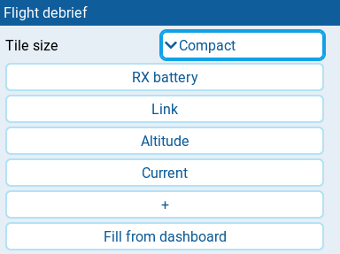
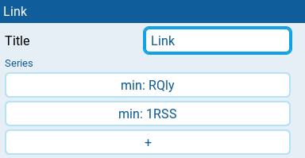

# Customize flight debrief

After a recorded flight, the flight debrief shows a flight summary and a set of
tiles with each tile's recorded values.

## Configure the tiles

**AeroGrid → Flight debrief** configures the current layout's post-flight tiles.
**Tile size** applies to the whole debrief: **Compact** or **Wide**.
Each tile has a title and up to three telemetry series. Tap a tile or series to edit, move, or delete it.
**Fill from dashboard** places RX battery and Link first, when present.

Leaving with changes offers **Save layout**, **Save layout as...**, or
**Discard changes**. These save the layout, including its debrief settings;
they do not save a flight recording.

## View the debrief

After a recorded flight, a green **Debrief ready** bar stays at the bottom
until the debrief is cleared. In fullscreen, tap it or drag it up to open.

The bar scrolls with the flight summary and tiles, rather than staying at the top;
press **RTN** or swipe down at the top to return to the dashboard.
Tile accents and badges show the worst recorded severity: red for critical,
yellow for warning, and blue otherwise. Values include the recorded source's
units unless the series overrides them.
Minimum and maximum values are marked **MIN** and **MAX**.

