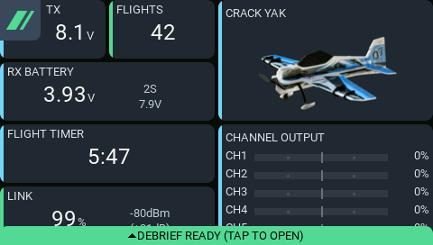
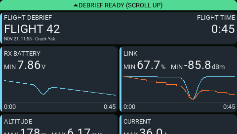

# Flight debriefs

  <iframe width="560" height="315" src="https://www.youtube-nocookie.com/embed/zqayzBjz4sg" title="Review and customize AeroGrid flight debriefs" loading="lazy" allow="accelerometer; autoplay; clipboard-write; encrypted-media; gyroscope; picture-in-picture; web-share" referrerpolicy="strict-origin-when-cross-origin" allowfullscreen></iframe>
  
<a href="https://www.youtube.com/watch?v=zqayzBjz4sg">Watch the flight debrief walkthrough on YouTube</a>.

After a recorded flight, the flight debrief shows a flight summary and a set of
recorded telemetry values.

## Preparation

Before flying, set up your arm switch and
[flight detection](model-settings.md#flight-detection) in **AeroGrid → Model settings**.
Flight detection must be enabled so AeroGrid can recognize when a flight ends
and prepare its debrief.

## View the debrief

After a flight, the **Preparing debrief** bar shows progress while AeroGrid
prepares your flight summary and telemetry charts. When it changes to
**Debrief ready**, enter fullscreen and tap the bar to review your flight.

Drag up or down to browse the charts. The scroll bar on the right shows
where you are in the debrief. Press **RTN** to return to the dashboard.

Yellow and red highlights help you spot warnings and critical readings from
the flight. **MIN** and **MAX** mark the lowest and highest recorded values.

## Configure the debrief

Open **AeroGrid → Flight debrief** to choose what you review after each flight.
These settings apply to the current layout.

Use **Enabled** to turn debriefs on or off. Choose **Compact** under **Tile size**
to see more tiles at once, or **Wide** for larger charts.

**Fill from dashboard** creates tiles from your existing dashboard panels.
This replaces any debrief tiles you've already configured.

Each tile can show up to three telemetry readings. Tap a tile to edit it, then
edit a series to choose its source and highlight its minimum, maximum, average,
or change over the flight. You can also move or delete tiles and series.

When you leave, choose **Save layout** to keep your changes. Use
**Save layout as...** to save a separate layout, or **Discard changes**
to leave without saving.
