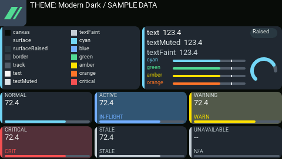
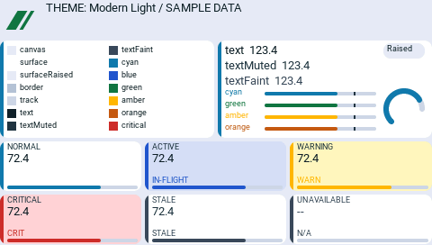

# Customize themes

## Choose a theme

Choose **Theme** in the widget settings.

| Theme | Description |
| --- | --- |
| **Dark** (default) | Dark, opaque panels on AeroGrid's dark background. |
| **Light** | Light, opaque panels on AeroGrid's light background. |
| **Glass** | Translucent panels over the radio theme background, with automatic light/dark colors and opacity. |

Glass uses the background image's average brightness to choose panel colors
and opacity. Text and status accents stay fully opaque. If the image cannot be
read, Glass uses dark panels at 80% opacity.

*Modern Dark palette.*

*Modern Light palette with dark text and light-background alarm tints.*

## Theme files and previews

Themes are stored as individual `.yml` files. Shipped themes live in
`/WIDGETS/AeroGrid/themes/`; add user themes to `/AEROGRID/themes/`. Theme names
are the filename stems, and user files override shipped files with the same
name. Restart the radio after adding a theme so it appears in the Theme picker.

## Create a custom theme

1. Copy a complete shipped theme to `/AEROGRID/themes/<name>.yml`.
   Use letters, digits, `-`, and `_` in the filename.
2. Set `name` to the filename stem and `label` to the name you want in the picker.
   Keep `version: 1` and all required color and spacing entries.
3. Change the colors, restart the radio, and select the new theme.
   Check its normal and alert states on a dashboard before using it.

Themes do not inherit from one another. Use spaces for YAML indentation, not
tabs. See the [theme-file reference](../reference-guide/yaml.md#theme-files) for
optional colors and contrast settings.
