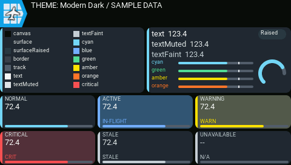
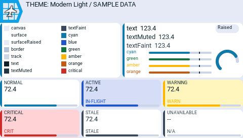

# Customize themes

## Choose a theme

Choose **Theme** in the widget settings.

| Theme | Description |
| --- | --- |
| **Modern Dark** | AeroGrid's dark instrument palette. |
| **Modern Light** | Pale instrument panels, dark text, and light-background accents and alarm tints. |

*Modern Dark palette.*

*Modern Light palette with dark text and light-background alarm tints.*

## Theme files and previews

Themes are stored as individual `.yml` files. Shipped themes live in
`/WIDGETS/AeroGrid/themes/`; add user themes to `/AEROGRID/themes/`. Theme names
are the filename stems, and user files override shipped files with the same
name. Restart the radio after adding a theme so it appears in the Theme picker.

Select **Palette** as the layout on a separate App-mode screen. It shows the
theme with fixed sample data, without
a receiver or telemetry setup. Switch the widget's **Theme** option between
Modern Dark and Modern Light to compare the same samples. Normal, active,
warning, critical, stale, and unavailable cards are shown together.

## Create a custom theme

1. Copy a complete shipped theme to `/AEROGRID/themes/<name>.yml`.
   Use letters, digits, `-`, and `_` in the filename.
2. Set `name` to the filename stem and `label` to the name you want in the picker.
   Keep `version: 1` and all required color and spacing entries.
3. Change the colors, restart the radio, and select the new theme.
   Check its normal and alert states in **Palette** before using it.

Themes do not inherit from one another. Use spaces for YAML indentation, not
tabs. See the [theme-file reference](../reference-guide/yaml.md#theme-files) for
optional colors and contrast settings.
