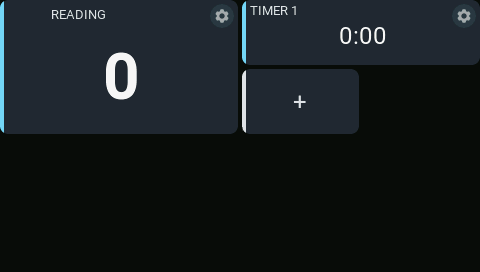
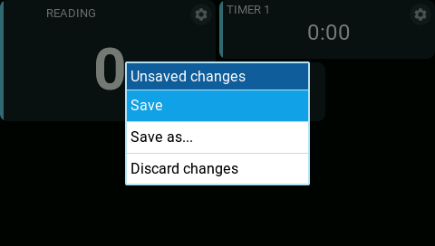
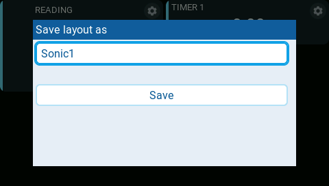

# Edit a dashboard on the radio

  <iframe width="560" height="315" src="https://www.youtube-nocookie.com/embed/hJtvJaOf7YY" title="Add, move, and resize AeroGrid panels" loading="lazy" allow="accelerometer; autoplay; clipboard-write; encrypted-media; gyroscope; picture-in-picture; web-share" referrerpolicy="strict-origin-when-cross-origin" allowfullscreen></iframe>
  
<a href="https://www.youtube.com/watch?v=hJtvJaOf7YY">Watch the panel editing walkthrough on YouTube</a>.

[Add a dashboard](add-dashboard.md) first, then customize its panels on the radio.

1. Long-press the dashboard to enter fullscreen. The EdgeTX logo in the
   top-left corner disappears.
2. In fullscreen, long-press a panel again to start editing.
   **Enter** also starts editing. A **gear**
   icon appears in the top-right corner of each panel.

| Action | How |
| --- | --- |
| Add | Tap the **+ panel**, then choose a panel type. Its settings open automatically. |
| Move | Drag the panel's body to a free position. |
| Reorder | Drag onto another panel. Compatible panels exchange positions or order; other panels stay put. |
| Resize | Drag the top-left, bottom-left, or bottom-right corner. The opposite corner stays fixed. |
| Configure | Tap the **gear** in the top-right corner. |
| Remove | Open the gear, then choose **Remove panel**. Removal is immediate. |

Panels snap to the 4 × 4 layout grid. Moves and sizes must fit without
overlapping other panels. The **+ panel** disappears when there is no free
cell. There are no grid lines or resize handles: drag the corners directly.
Moving and resizing require touch.

## Configure panels

Use the native choices, toggles, number controls, and text keyboard in the
settings dialog. Sources, switches, and timers use EdgeTX pickers.

Panel titles use the full header width when no state badge is shown. When a
badge appears, only its displayed width and a small gap are set aside. Titles
never use a smaller font than their badges; a title that still does not fit is
shortened, or hidden if too little room remains. The full title returns when
space allows, without moving the title or the panel's reading.

Metrics and State entries appear as named rows with a summary of their settings.
Tap a row to edit it, or tap the full-width **+** row to add an entry.
In a metric entry, choose **Source** to change the reading.

In a State entry, open a state to edit **When**, **Text**, and **Background**.
The first true condition wins. Each entry supports up to three conditions;
**+** appends one at the bottom. Delete and recreate a condition to change
its priority. Background choices are **normal**, **active**, **warning**, and
**critical**. The main entry's winning choice sets the whole panel's appearance,
including its background, sidebar, text colors, and badge. Supporting entries
never change the panel mode.

Press **RTN** or tap outside a dialog to return one level. Changes remain in
your draft.

If settings cannot be previewed, a **Panel preview failed** message appears.
Open its details to read the full panel-specific explanation, then correct
the settings. The short status line clears when the preview succeeds.
In Companion's simulator, caught errors also appear in **View > Debug Output**
(**F6**), with repeated messages suppressed. See
[Simulator logs and caught errors](../developer-guide/testing.md#simulator-logs-and-caught-errors)
for console filters and persistent logging.

## Save or discard changes

From the editing dashboard, press **RTN**. If nothing changed, editing closes.
Otherwise choose an action:

| Action | Result |
| --- | --- |
| **Save** | Updates the current layout and exits editing. |
| **Save as...** | Asks for a name and saves a separate layout. |
| **Discard changes** | Exits editing and restores the saved layout. |

Save As suggests `<model name>-L<number>`, using the first unused number
starting at 1, such as `Sonic-L1` or `My-Glider-L1`.
You can change the suggestion using letters, digits, `-`, and `_` (at most
24 characters). An existing name requires overwrite confirmation.
Press **RTN** in the name dialog to return to the exit menu without losing
your draft.

**After Save As, restart the radio and select the new name in the widget's
Layout setting.** The widget cannot change its own settings, so it continues
showing its previous layout until you select the new one.

Layout picker positions are retained in `/AEROGRID/layout-registry.txt`.
If upgrading an existing installation with `/AEROGRID/registry.txt`, rename
that file to `layout-registry.txt` before starting the radio to preserve saved
Layout selections. Do not edit or reorder its entries.

Wait for saving to finish before powering off. A save error keeps your draft
so you can retry; the previous saved file is retained as `.bak`.

See [Understand layouts](add-dashboard.md#understand-layouts) for where saved
layouts live and how multiple dashboards share them.
