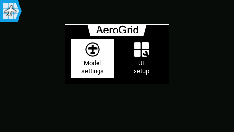
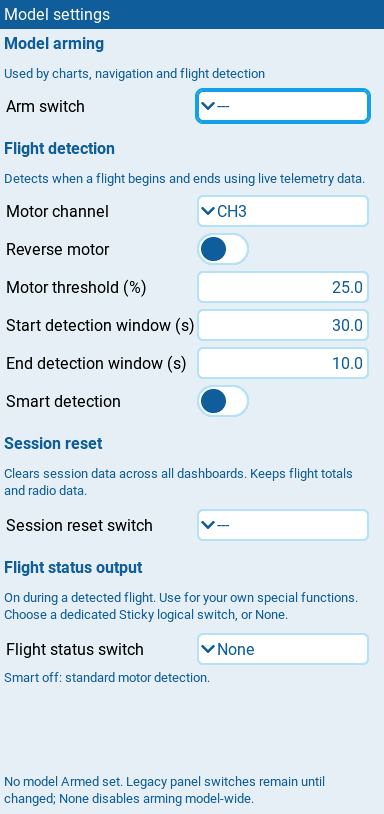
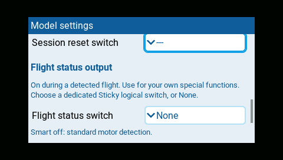
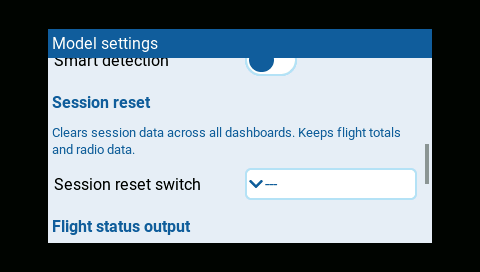

# Edit model settings

Long-press the AeroGrid dashboard to enter fullscreen. The AeroGrid icon
appears in the top-left corner. Tap it, then choose **Model settings**.

Settings apply to every AeroGrid dashboard for the selected model, not to an individual panel
or layout. Each confirmed change saves automatically; Back closes the page.

## Arming

Arming tells AeroGrid when your model is armed, using the switch condition
you select. It starts Chart recording, captures Navigation's **first-arm**
home, starts flight-session minimum tracking, and enables flight detection.
It only observes your model's state; it does not arm the aircraft or control
the motor.

| Setting | Default | What it does |
| --- | --- | --- |
| **Arm switch** | none | Physical switch position or logical switch (including inverted logical switches) that means armed. |

Saving **None** for Arm switch disables arming across all dashboards.
Older layouts retain their panel/session arm switches only until model arming
is saved. Those legacy controls disappear once model arming takes precedence.
Numeric sources such as `ch5` or `sa` are not arm conditions.

## Flight detection

Flight detection distinguishes a flight from simply being armed. It observes
the armed condition, motor output, and live telemetry to confirm a flight
start, then confirms its end after sustained disarming.

Each confirmed start increments the model's flight total once, shown by
Flight counter. Detection also supplies Chart flight shading, keeps recording
running through the end-detection window, and drives the optional
[Flight status output](#flight-status-output) for your sounds or announcements.
It runs across the model's dashboards even without a Flight counter panel.

| Setting | Default | What it does |
| --- | --- | --- |
| **Motor channel** | CH3 | Channel used to measure motor output. |
| **Reverse motor** | off | Enable when the motor channel runs from high at idle to low at full power. |
| **Motor threshold (%)** | 25 | Motor output must be strictly above this percentage to qualify a flight. Valid values are 0 up to, but not including, 100. |
| **Start detection window (s)** | 30 | Continuous armed state, sufficient motor output, and live telemetry required to confirm flight start. |
| **End detection window (s)** | 10 | Continuous disarming required to confirm flight end. Rearming within this window keeps the flight open. |
| **Smart detection** | off | Also allows sustained altitude or GPS groundspeed evidence to confirm takeoff earlier. See [Flight counter](../panels/flight-counter.md#behavior). |

Flight detection observes live telemetry; it does not arm the aircraft.
Both detection windows accept values greater than 0 and up to 3600 seconds.
Flight timestamps use the beginning of each window, not the later confirmation.

### Flight status output

**Flight status switch** exposes the detected flight session through a
dedicated Sticky logical switch. It turns on when flight start is confirmed
and off when flight end is confirmed, including the end-detection window.
Session reset also turns it off. Choose **None** to disable the output.

For example, reserve an unused **L01** in EdgeTX's **Logical Switches** page:

| Switch | Function | V1 | V2 | AND switch | Delay | Duration |
| --- | --- | --- | --- | --- | --- | --- |
| L01 | Sticky | unassigned | unassigned | unassigned | 0.0 s | 0.0 s |

Then select **L01** as AeroGrid's **Flight status switch**. The picker lists
configured logical switches. AeroGrid controls the switch's state; leave its
inputs unassigned and reserve it exclusively for this output.

Use **L01** in an EdgeTX Special Function to play your chosen sound when a
flight starts; use **!L01** for an action when it ends. Configure the Special
Function's startup and repeat options to avoid unwanted announcements.
Do not also use this switch as the Arm switch or Session reset switch, or
share it with another script. It is not a safety interlock.

## Session reset

Set **Session reset switch** to a physical switch position or logical switch.
Activation resets the following AeroGrid session data across all dashboards,
including hidden screens:

| Panel or service | What resets |
| --- | --- |
| Chart | Recordings, recorded extrema, flight shading, and arm/resume markers. |
| Link status / Extrema Service probe | Flight-session minima, maxima, and session timing. |
| Navigation | First-arm captured home; a new disarm/arm transition is needed to capture again. |
| RX battery | Automatic cell estimate; fresh voltage supplies the next estimate. |
| Flight counter / detection | Pending or active detection and its flight-status output, not the flight total. |

Reset runs once per off-to-on transition, not continuously while held.
An input already on at startup, after changing the setting, or after signal
recovery does not trigger a reset. Choose **None** to disable it.

Reset during a flight cancels detection without creating a completion.
Disarm before another flight can be counted. Flight totals, radio timers,
radio telemetry minima/maxima, EdgeTX home, saved settings/layouts, and
unsaved editor changes are preserved. Other panels continue showing live data.
