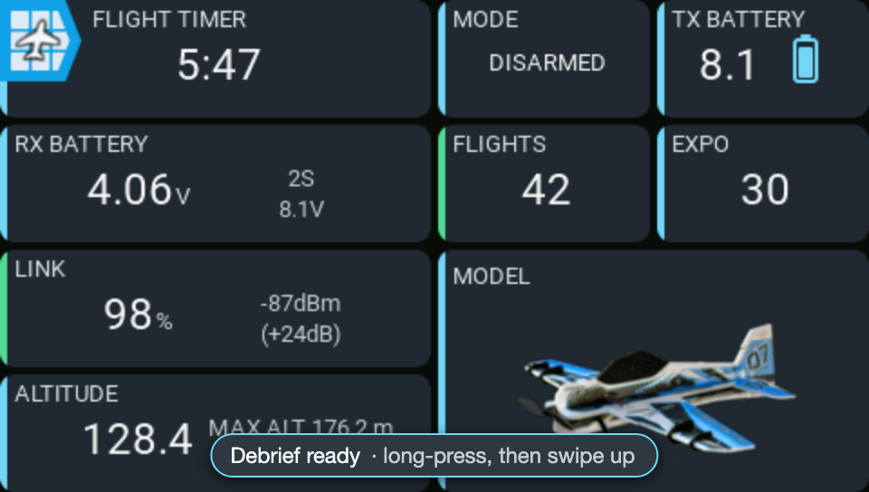
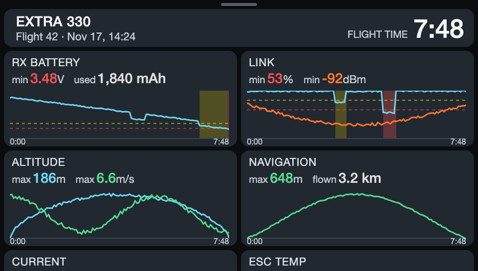
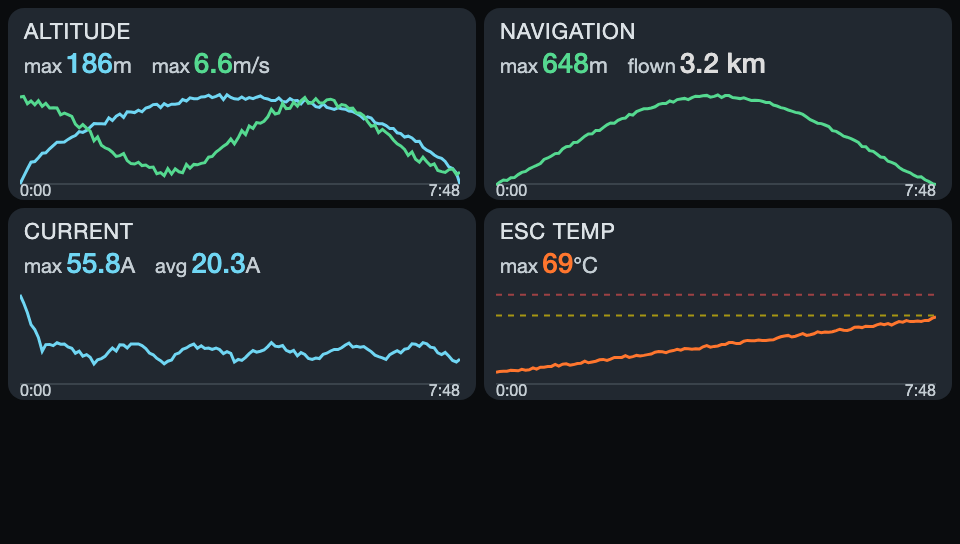

# Post-flight debrief

> Design plan. No code has been written yet. The design is settled; the
> implementation order is at the end.

After a flight completes, AeroGrid shows a short summary of that flight: one
chart per value with the flight statistics that matter, with warning and
critical periods highlighted. The goal is to answer "how did that flight go?"
at a glance without opening a log file on a computer.

## User experience

### The pill



- When flight detection reports a completed flight, the dashboard shows a
  pill at the bottom center.
- Pill text:
  - Outside widget fullscreen, including App mode: **Debrief ready ·
    long-press, then swipe up**
  - In widget fullscreen: **Debrief ready · swipe up**
- The pill is plain text: no "new" dot, no arrow.
- The pill means "a new debrief exists". It stays until the debrief is opened
  or the session is reset.
- Each dashboard shows its own pill for its own debrief.

### Opening and closing



- Swipe up opens the latest debrief; swipe down hides it. Swipe up always
  works after a flight, even after the pill has gone.
- The widget only receives touch in widget fullscreen; App mode does not
  deliver touch either. Outside fullscreen the user long-presses first
  (hence the pill wording).
- Opening is touch only, like the AeroGrid menu. Once open, the rotary
  encoder scrolls and RTN closes the debrief. Key-only access to the menu
  and the debrief is a separate issue.
- Leaving widget fullscreen closes the debrief.

### Layout



- **Header card:** model name, flight number, flight start date and time
  (for example "Flight 42 · Nov 17, 14:24"), and the flight time in large
  digits. No alarm-count badge. When the radio clock looks unset (year
  before 2024), the date is hidden and only the flight number is shown.
- **Tiles:** a flat list of chart tiles, no sections. Tile sizes use the
  dashboard's 4 x 4 grid, like panels, so they scale with the screen:
  - **Compact** 2 x 2: half the width and half the height of the screen.
  - **Wide** 4 x 2 or 4 x 1: the full width, at compact height or half of it.
- The same grid rules apply on every screen, including portrait; there are
  no special cases per radio.
- The whole debrief scrolls vertically, header included. There is no scroll
  bar. The mockup images predate the grid-based sizes.
- A small grab handle sits at the top of the sheet.

### Tiles

Each tile is essentially a Chart panel configuration with one to three
series:

- Title at the top left, like a panel title. No colored side stripe.
- Legend: for each series, its label and flight statistic instead of the
  live value, for example `min 3.48V`, `max 186m`, `avg 20.3A`,
  `delta 1,840 mAh`, `flown 3.2 km`. The source name is never shown. The
  value is colored by the worst level the series reached (normal, warning,
  critical).
- When the legend does not fit, the labels are dropped first, then series
  values from the right. Every series is
  still drawn in the chart.
- Chart window is exactly the detected flight, with axis labels `0:00` and
  the flight time.
- Warning and critical periods are shaded amber and red, with dashed
  threshold lines.
- No markers at the minimum or maximum; the curve makes them obvious.
- Tapping a tile does nothing for now (no enlarged chart).

## Configuration

- The debrief is part of the **layout**, like its panels. Different
  dashboards can have different debriefs.
- A new AeroGrid menu item, **Flight debrief**, sits next to **Model
  settings** and **UI setup** and configures the debrief of the current
  layout.
- Edits follow the existing layout rules: changes are a draft until **Save**
  or **Save as**; editing a bundled layout creates a user copy.
- A debrief is an ordered list of tiles. Each tile has a title, a size
  (Compact 2 x 2, Wide 4 x 2, Wide 4 x 1), and one to three series. Each
  series uses the Chart panel's series settings (source, label, range, unit,
  precision, color) plus a statistic: min, max, avg, or delta (end minus
  start). The label defaults to the statistic word and can be overridden,
  for example `flown`; a cleared label falls back to the statistic word.
  The time window is always the flight.
- The debrief is stored in an optional `debrief` section of the layout file:

  ```yaml
  debrief:
    tiles:
      - title: RX battery
        colSpan: 2          # required: 2 x 2 Compact, 4 x 2 or 4 x 1 Wide
        rowSpan: 2          # required
        series:             # 1 to 3
          - source: VCel    # telemetry sensor name
            statistic: min  # min, max, avg, or delta
            label: low      # optional; defaults to the statistic word
            rangeMin: 3.0   # optional, like Chart series
            rangeMax: 4.2
            unit: V
            precision: 2
            accent: cyan
  ```

- A layout without a `debrief` section has no debrief (no pill, nothing
  recorded) until it is filled; see Automatic population. An empty tile list
  is a valid, empty debrief and is never filled automatically.
- Validation follows the panel rules. Invalid series are dropped; a tile with
  no valid series, a missing or bad size, or no title is dropped. On load the
  errors become notices and the rest is used; in the editor they block Save.
  Unknown settings are reported as notices but kept, and do not block Save,
  so an older version never destroys a newer layout's settings.
- Saving a change to only the debrief does not reload the dashboard.

- A list page, not a visual editor: the tiles are listed by title and size.
  Selecting a tile opens its settings in the shared settings UI.
- Actions: **Add**, **Remove**, **Move up**, **Move down**, and **Fill from
  dashboard**.
- Works with touch and keys, like other settings pages.

### Automatic population

- A layout that has never had a debrief is filled automatically from its
  panels, so the debrief works out of the box.
- **Fill from dashboard** rebuilds the tiles from the panels, replacing the
  current tiles after confirmation.
- Mapping, in panel order; every tile starts Compact:

  | Panel | Tile series |
  | --- | --- |
  | Battery | `VCel` min |
  | Link | link quality min, `Mrgn` min, `Drop` delta |
  | Navigation | `HDst` max, `FDst` delta |
  | Chart | the same series |
  | Metric | one series per entry: min when its warnings trigger on falling values, otherwise max |

- Panels without telemetry (timer, flight mode, model, trims, and similar)
  are skipped.

## Data

### Telemetry sources

- Every debrief series is a telemetry sensor name. There are no special
  Battery, Link, or Navigation tile types.
- Values that AeroGrid computes itself are published as EdgeTX sensors with
  `setTelemetryValue`, so they can be charted, logged, and used anywhere
  else in EdgeTX. Only values EdgeTX cannot calculate itself are published:

  | Sensor | Panel | Unit | Value |
  | --- | --- | --- | --- |
  | `VCel` | Battery | V, 2 decimals | Lowest cell from a cells monitor, or pack voltage divided by the configured or estimated cell count |
  | `Mrgn` | Link | dB | ELRS RSSI margin |
  | `Drop` | Link | s | Accumulated time without a link |
  | `HDst` | Navigation | m | Distance to home, including a switch-captured home |
  | `FDst` | Navigation | m | Accumulated distance flown |

- The panels that compute these values (Battery, Link, Navigation) publish
  them automatically. No panel means no sensor; there is no move of this
  logic into Model settings.
- EdgeTX only creates a published sensor while **Discover new sensors** is
  running (verified in the EdgeTX 2.12.4 simulator). The user runs Discover
  once per model with AeroGrid on screen; the sensors then stay in the
  model. Until then, the Flight debrief setup page shows "Run Discover new
  sensors in Model > Telemetry" next to tiles whose sensor is missing.
- Published values are read back with `getSourceValue`, which works without
  a receiver link; `getValue` returns 0 then.
- `Drop` and `FDst` behave like any other accumulating telemetry, such as
  consumption: they keep counting until EdgeTX telemetry is reset. The
  debrief shows a flight's share with the `delta` statistic.
- `Drop` starts counting only once the link has been up since the last
  telemetry reset, so a radio waiting for its receiver adds nothing.
- `FDst` counts a GPS fix only once it is at least 5 m from the last counted
  point, so a stationary model does not gain distance from GPS drift.
- Only the first panel of each type on a layout publishes; further panels of
  the same type are ignored.
- Panels publish from their background hook too, so sensors keep updating
  while the dashboard is hidden.

### Thresholds

- EdgeTX sensors carry no warning or critical thresholds.
- Panels register their configured thresholds with the dashboard's telemetry
  service, and debrief charts read them from there. Thresholds therefore come
  from panels on the same layout.
- Thresholds belong to telemetry, not to the history: they describe how to
  judge a sensor's value, live or recorded. History records values only.
- Thresholds do not change during a flight, so the shaded periods and the
  worst level per series are derived at flight end from the recorded values.
  No alarm state is recorded.

### Recording

- Charts reuse the Chart panel recording (`history_service`), including gaps
  for stale telemetry. `history_service` records only subscribed sources, so
  the debrief's series are subscribed when the layout loads and after every
  Save, before the flight starts.
- At flight end, the flight slice of each series is copied at its tile's
  chart width (one point per pixel column). Statistics are computed from the
  full recording of the flight, so they do not depend on chart width; avg is
  time-weighted.
- Each dashboard records its own debrief. Hidden dashboards keep their
  services running, so changing screens mid-flight loses nothing.
- Only the latest debrief is kept, in memory. A new flight replaces it, and
  it is lost on power off or when the dashboard reloads, like Chart
  recordings. Saving the layout keeps it.

## Rules

- **Short flights:** flights shorter than the model's *Minimum flight
  duration* are not counted by flight detection, so they create no debrief.
- **No flight detection:** no flight completes, so there is no debrief. The
  Flight debrief setup page stays available, because a layout can be used by
  several models; it shows a note that a debrief needs flight detection.
- **Session reset** clears the debrief and the pill, like Chart recordings.
  `Drop` and `FDst` are unaffected; only an EdgeTX telemetry reset clears
  them.
- **Conflicting thresholds:** when two panels set thresholds for the same
  sensor, the first panel in layout order wins.
- **Tile limit:** at most 12 tiles per debrief (up to 36 series of about 200
  points), to protect the 6 MiB Lua heap. **Add** is disabled at the limit.

## Codebase anchors

| Area | Location |
| --- | --- |
| Flight phases and completion | `lib/flight_service.lua` |
| Touch and swipe forwarding | `main.lua` (touch event handling) |
| Panel background hook | `main.lua` (panel background tasks) |
| Recording engine | `lib/history_service.lua` |
| Shared telemetry subscriptions | `lib/telemetry_service.lua` |
| Battery cell logic | `panels/rx-battery.lua` |
| ELRS margin and link state | `panels/link-status.lua` |
| Distance and home | `lib/navigation_service.lua` |
| AeroGrid menu items | `lib/aerogrid_menu.lua` |
| Chart behavior to mirror | `docs/panels/chart.md` |

## Implementation order

Each step is a separate pull request that can be reviewed and merged on its
own. Nothing user-visible is half finished between steps.

1. **Published sensors.** Battery publishes `VCel`; Link publishes `Mrgn`
   and `Drop`; Navigation publishes `HDst` and `FDst` (new distance
   accumulator). Includes publishing from the background hook. Useful on its
   own. Can be split into Battery and Link, then Navigation.
2. **Threshold registry.** Panels register thresholds with the telemetry
   service; the first panel in layout order wins. Not visible; tests only.
3. **Debrief configuration.** The data and rules, without UI: the debrief
   section in the layout file, validation, the tile limit, and Save and Save
   as. A layout without a debrief section has no debrief.
4. **Recorder.** A debrief service copies the flight slice from
   `history_service` at flight end and computes statistics and shaded
   periods. Session reset clears it. Headless and tested.
5. **Setup page.** The Flight debrief menu item, the tile list page, tile
   settings, the flight-detection note, and the missing-sensor hint. Edits
   the data defined in step 3.
6. **Debrief view.** Header and tiles, shading, legend overflow, scrolling.
   Swipe up and down in fullscreen, rotary scrolls, RTN closes, leaving
   fullscreen closes.
7. **Pill.** Both texts and the pill lifecycle. The feature now works end to
   end with a debrief built on the setup page.
8. **Automatic population.** The panel-to-tile mapping, filling layouts that
   have never had a debrief, and the **Fill from dashboard** action on the
   setup page.
9. **Documentation.** User guide page, including running Discover new
   sensors once, and real screenshots replacing the mockup images.

Steps 1, 2, and 3 are independent. Step 4 needs steps 2 and 3; steps 5 to 8
follow in order.

Sensor IDs are chosen in step 1.
